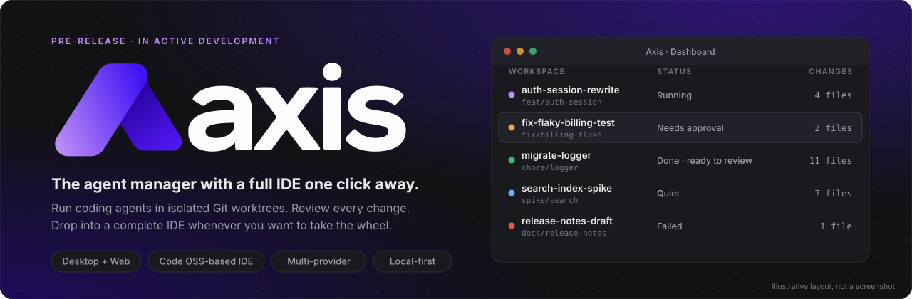
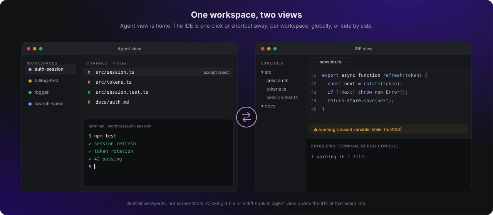
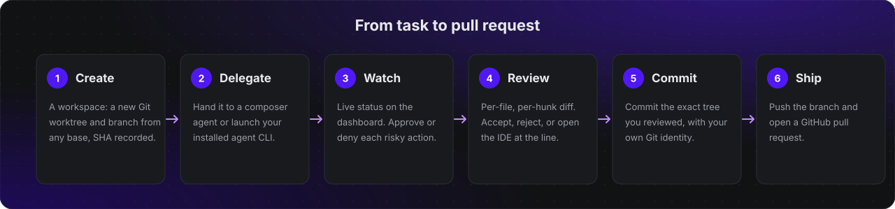
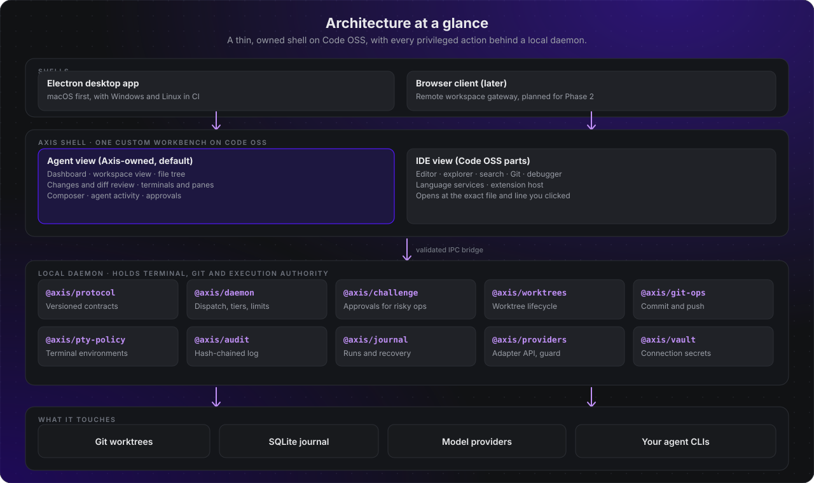
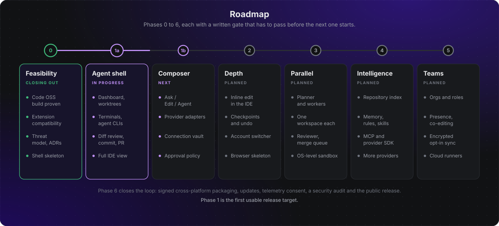

<p align="center">
  
</p>

<p align="center">
  <a href="https://github.com/DylanLambertson/Axis/actions/workflows/ci.yml"></a>
  
  
  
  
  
  
  <a href="LICENSE"></a>
</p>

<p align="center">
  <a href="#what-is-axis">What is Axis</a> ·
  <a href="#features">Features</a> ·
  <a href="#how-it-works">How it works</a> ·
  <a href="#architecture">Architecture</a> ·
  <a href="#security-and-trust">Security</a> ·
  <a href="#roadmap">Roadmap</a> ·
  <a href="#where-the-project-stands">Status</a> ·
  <a href="#documentation">Docs</a> ·
  <a href="#work-with-me">Contact</a>
</p>

<p align="center"></p>

## What is Axis

Axis is a desktop and web **agent manager for software development**, with a complete IDE built in.

Coding agents are now good enough to take real tasks, but the tools around them are still either a chat box bolted onto an editor or a pile of terminals. Axis is built for the way people actually work with agents today: start several tasks, let them run, check in on whichever one needs you, review what came back, and only then reach for the editor.

- **Agent first.** The home screen is a dashboard of workspaces, not a file tree. Every workspace is an isolated Git worktree and branch where an agent works, with its own terminals, changes and diff review.
- **A real IDE, one step away.** Any file or diff opens in a full Code OSS-class IDE: editor, language services, debugger, extensions. Toggle per workspace, toggle globally, or split the window and keep both.
- **Bring your own models and tools.** Use the agent CLIs you already have installed, or Axis's own composer with a connection to the model providers you choose. Both go through the same review gate.
- **Local first, privileged work behind a daemon.** Terminals, Git and execution authority live in a local daemon, and every risky action goes through an explicit, single-use approval.
- **Honest about what it guarantees.** Worktrees isolate edits, not privileges. Axis never calls them a sandbox, and never claims a provider feature it has not verified through an official path.

> **Not a VS Code copy.** Axis is not an editor with dashboards added on. The agent manager is the primary surface and the IDE is a secondary view of the same workspace, but never a reduced one.

<p align="center"></p>

<p align="center"></p>

## Features

Status key: ✅ built and merged · 🔨 in progress or in review · 🧭 planned. Phases refer to the [roadmap](#roadmap).

### Agent manager (Phases 1a and 1b, the first usable release)

| Capability | What it does | Status |
|---|---|---|
| **Workspaces on worktrees** | One Git worktree and branch per task, created from any base with the base SHA recorded. List, focus, rename, archive and remove. Removal refuses to discard uncommitted work without explicit confirmation. Worktrees live outside your repository, under the app data directory. | 🔨 |
| **Dashboard** | One dense row per workspace: name, branch, agents and their state (idle, running, waiting for approval, quiet, failed, done), terminals, changed files, last activity. | 🔨 |
| **Terminals and split panes** | Terminals bound to the workspace's worktree, split into panes, with the layout remembered per workspace. | 🔨 |
| **First-class CLI agents** | Launch the agent CLIs you already have installed, through their documented command lines, under your own login and terms. Each launch becomes a run on the dashboard. The CLI's own permission prompts stay in its terminal. | 🔨 |
| **Diff review** | Changed files against the workspace base. Accept or reject per file and per hunk, with protected paths highlighted and a flag for files you changed yourself during a run. | 🔨 |
| **Commit, push, pull request** | Commit the exact tree you reviewed with your own Git identity, push one explicit branch, and open a GitHub pull request. | ✅ commit and push logic · 🔨 UI |
| **Composer** | One composer with explicit Ask, Edit and Agent modes, bound to the focused workspace, with streaming output, a live activity feed and an approval UI. | 🧭 Phase 1b |
| **Provider connections** | A provider adapter contract with a mock provider and a reusable contract test suite. The Anthropic API comes first, with the key held in a connection vault. | ✅ adapter API · 🔨 first adapter and vault |
| **Approvals** | Risky actions request approval. Approvals are single-use, bound to the exact request, and confirmed through a native dialog the renderer cannot fake. | ✅ engine · 🔨 UI |
| **Crash recovery** | A local journal records workspaces and runs. Kill the app mid-run, restart, and the workspaces, layout and run records come back with the worktree intact. | ✅ journal · 🔨 wiring |

### IDE view (Phase 1a)

A full IDE for the focused workspace, built on [Code OSS](https://github.com/microsoft/vscode) rather than a reduced editor: multi-tab editing and splits, breadcrumbs, search and replace, symbols, command palette and keybindings, an integrated terminal and tasks, Git staging, diffs and merge, a debugger, diagnostics, language services, formatters, themes and settings, and extension support subject to the compatibility matrix. Clicking a file or a diff hunk in Agent view opens the IDE at that exact line, and switching back preserves your place.

### View modes

- **Per-workspace toggle:** each workspace remembers whether you were in Agent view or the IDE.
- **Global toggle:** flip every workspace at once.
- **Split:** Agent view and the IDE side by side, so a file click opens in the IDE pane.

Focus rules are specified so that typed keys always reach the destination view's last focused element, never a terminal in another workspace, and the switch is announced to screen readers. The three modes are tested keyboard-only.

### Beyond the first release

| Area | Planned capabilities | Phase |
|---|---|---|
| **Agent depth** | Inline edit and inline diff in the editor, selection, file and symbol context attachments, a model and account switcher, capability display, conversation history, checkpoints with undo, prompt templates, cost and usage where a provider reports it. | 2 |
| **Parallel orchestration** | Delegate one goal to several workers, each in its own workspace. Planner, worker and reviewer roles, a task graph with dependencies, a merge queue, budgets, retries, resumability and an OS-level sandbox for agent subprocesses. | 3 |
| **Project intelligence** | Local repository indexing, a file and symbol graph, task and decision history, project rules, reusable skills, retrieval with provenance and expiry, and explicit, consented sharing across projects. | 4 |
| **Artifacts** | Native project documents, structured plans, notes, diagrams, task boards and exportable reports. | 4 |
| **Extensibility** | MCP client and server integration with scoped permissions, a custom provider SDK, custom tools and a curated extension catalog. | 4 |
| **Teams** | Organizations, roles, project sharing, presence, co-editing, comments, shared agents, review and approval, an audit trail, and encrypted opt-in sync with cloud runners. | 5 |
| **Release** | Signed cross-platform packaging and updates, telemetry with consent, a security audit and onboarding. | 6 |

<details>
<summary><b>Explicit non-goals for the first release</b></summary>

- Re-implementing every feature of every proprietary agent product. Where a provider feature has no official, documented path, Axis labels it unavailable instead of faking it.
- Guaranteeing access to the Visual Studio Marketplace. Axis uses [Open VSX](https://open-vsx.org) and does not offer Microsoft-licensed extensions.
- Unrestricted autonomous deployments.
- Automatic knowledge sharing across tenants.
- Feature-identical browser and desktop shells.

</details>

<p align="center"></p>

## How it works

<p align="center"></p>

1. **Create.** Pick a repository and a base branch. Axis creates a worktree and a branch outside your repository and records the base SHA, so every later diff is against a known point.
2. **Delegate.** Hand the task to the composer, or launch an installed agent CLI in a terminal bound to that worktree. Axis never runs an agent in your own checkout.
3. **Watch.** The dashboard shows each run's state from process and terminal state Axis owns. When an agent asks for something risky, you see it and answer it.
4. **Review.** Read the diff per file and per hunk. Accept, reject, or open the IDE at the line to fix it yourself.
5. **Commit.** Commit exactly the tree you reviewed. If a file changed after review, the commit refuses.
6. **Ship.** Push the branch with an explicit refspec and open the pull request. Axis warns before pushing a diff that contains a secret-shaped string.

### The product model in one table

| Term | Meaning |
|---|---|
| **Workspace** | An isolated Git worktree and branch for one task, with its agents, terminals and changes. A repository can have many at once. Your own checkout is listed as the local checkout and is never an agent workspace. |
| **Dashboard** | The home screen: every workspace with its agents, status, terminals and changes. |
| **Agent view** | The dashboard plus the focused workspace: file tree, changes, diff review, terminals, composer and agent activity. |
| **IDE view** | The full IDE for the focused workspace. |
| **Run** | One execution of an agent in a workspace, tracked through a state machine and recorded in the journal. |

<p align="center"></p>

## Architecture

<p align="center"></p>

Axis is one custom workbench on Code OSS with two views. The Agent view is Axis-owned code. The IDE view reuses upstream workbench parts, and the footprint on the upstream tree is kept small and measured, so tracking Code OSS stays affordable. Everything privileged happens in a **local daemon** behind a validated IPC bridge. The renderer cannot reach the operating system directly.

### Axis packages

Axis-owned TypeScript that does not need Code OSS services lives in `packages/*` as npm workspaces. Each package has a narrow job, an import allow-list enforced by tests, and no hidden dependency on Electron.

| Package | Responsibility | Status |
|---|---|---|
| `@axis/protocol` | Versioned message envelope, a closed set of structured errors, bounded message inspection that rejects shared references, accessors and prototype tricks, and the shape of approval challenges. | ✅ |
| `@axis/daemon` | Transport-agnostic daemon core: connections and handshake, dispatch, permission tiers, idempotency, cancellation, timeouts, backpressure and error sanitising. Approval is owned by the pipeline, so handlers never see a credential. | ✅ |
| `@axis/challenge` | Approval challenges for destructive operations. Single-use, bound to the exact request digest, target and content, burned before any await, with quotas per actor and window. | ✅ |
| `@axis/pty-policy` | Pure logic for terminal environments and agent CLI launch: the environment deny-list, Git environment allow-list, settings scope rules, and executable resolution that never trusts the working directory. | ✅ |
| `@axis/git-ops` | Daemon-orchestrated commit and push. Commit binds the reviewed tree, push uses one explicit refspec, history is scanned for secrets, and both refuse while a CLI run is active. | ✅ |
| `@axis/audit` | Secret redaction, canonical JSON, and a hash-chained append-only audit log on SQLite, with a data-directory safety check. | ✅ |
| `@axis/journal` | Durable workspaces and runs, the run state machine, idempotency keys and restart recovery. | ✅ |
| `@axis/providers` | The provider adapter API: normalised requests and stream events, capability reports, an error taxonomy, a daemon-side guard (budgets, redaction, timeouts, stream checks), a mock provider and a reusable contract suite. | ✅ |
| `@axis/worktrees` | The worktree lifecycle manager: create, list, remove, base SHA, uncommitted-work protection and drift detection that never executes repository-controlled code. | 🔨 in review |
| `@axis/anthropic` | The first real provider adapter, for the Anthropic Messages API. | 🔨 in review |
| `@axis/vault` | The connection vault for provider credentials. | 🔨 in review |

### Technology

| Layer | Choice |
|---|---|
| Shell | Electron, on a custom workbench over a pinned Code OSS (currently 1.144), applied as reviewable patches plus an overlay |
| UI | TypeScript, with React planned for the Agent view, subject to the compatibility checks in Phase 1a |
| Daemon and services | Node 24 and TypeScript 7, with Zod 4 for every wire schema |
| Local data | SQLite (`node:sqlite`) with a hash-chained audit log |
| Git | The system Git CLI, driven through an allow-list of commands |
| Extensions | Open VSX, with an Axis-owned signature verifier planned |
| CI | GitHub Actions on Linux and macOS, with six required checks |

<p align="center"></p>

## Security and trust

Axis runs other people's code on your machine and holds your provider credentials, so security is part of the design, not a later phase. The full model is in [`docs/SECURITY.md`](docs/SECURITY.md) and the two [threat models](docs/security/). Some of the controls below are enforced by packages that are already merged, and the rest are gates that Phases 1a and 1b must pass before they ship.

- **Isolation is stated plainly.** Workspaces are Git worktrees, not security sandboxes. Agent CLIs run with your privileges and credentials under their own permission models. Axis surfaces what they do and does not pretend to contain them. An OS-level sandbox is planned for Phase 3.
- **Clean terminals.** An agent CLI's environment is built from an allow-list and a deny-list. It never receives Axis variables, editor or askpass hooks injected by extensions, Git variables that redirect or inject configuration, or credentials.
- **Approvals that cannot be replayed.** A tier 3 to 5 action needs an approval bound to the exact request, issued by the daemon, confirmed through a native dialog, usable once, and attributed to a person. An agent cannot approve itself.
- **A tamper-evident audit trail.** Every user and daemon action writes a hash-chained event with the actor's identity, with secrets redacted before anything is stored. Edits, reordering and mid-chain deletions are detected, and the chain head is anchored outside the database to catch tail truncation.
- **Git is handled defensively.** Daemon Git calls never run hooks or filter drivers. User-controlled values are passed after `--`. A worktree's Git directory is snapshotted around every run, and drift in hooks, `core.hooksPath`, `insteadOf`, `pushurl` or credential helpers is flagged and blocks commit and push until acknowledged.
- **Secrets stay in the vault.** Provider keys live in a connection vault, never in logs, renderer state, prompts or agent environments. A run stops before the next provider request once its budget is reached.
- **Official paths only.** Axis never reads another tool's private session store, extracts tokens or impersonates a client.
- **Supply chain.** Code OSS is pinned by commit with checksum-verified toolchains, patches are reviewable, third-party extensions come from Open VSX. Packaged builds refuse to install an extension because the signature verifier is not yet available, and the signed, unsigned and tampered-package test is still open.

<p align="center"></p>

## Roadmap

<p align="center"></p>

Each phase ends with a written gate. A phase is done when its gate passes, not when its features exist.

| Phase | Focus | Gate, in short |
|---|---|---|
| **0 · Feasibility** | Prove Code OSS can carry the shell. Build tooling, extension compatibility matrix, licensing and marketplace review, threat model, ADRs, prototypes of alternatives, and an agent-view skeleton. | Basic IDE operations work on the custom shell with a credible upstream maintenance strategy. The shell boots into a dashboard and a workspace view. Per-workspace and split modes work. The shell footprint is measured. |
| **1a · Agent workspace shell** | Dashboard, worktrees, terminals and panes, CLI agent launch, diff review, commit and push, GitHub pull request, the full IDE view, the daemon bridge, journal and audit log. | End-to-end scenarios pass with an installed agent CLI. Environment scrubbing, drift detection, approvals, audit tamper detection and crash recovery are each proven by test. |
| **1b · Composer and brokered agent** | Ask, Edit and Agent modes, the first provider adapter, the connection vault, a tool broker with an approval policy, activity streaming. | The composer completes the dashboard-to-pull-request scenario with the mock provider and a real API. Approvals block, budgets stop runs, and no credential reaches a log or an agent. |
| **2 · Depth** | Inline edit, context attachments, account switcher, history, checkpoints, undo, templates, a browser skeleton. | Inline edit produces a reversible diff. Restoring a checkpoint returns the worktree to its recorded state. |
| **3 · Parallel orchestration** | Planner, workers and reviewer, a task graph, a merge queue, budgets and an OS sandbox. | Two workers implement tasks independently in separate workspaces, pass validation and integrate without silent overwrites. |
| **4 · Intelligence and extensibility** | Indexing, memory, rules, skills, a knowledge graph, MCP, the provider SDK and more providers. | Retrieval is provenance-aware, deletion works, projects are isolated from each other and plugin contracts are tested. |
| **5 · Teams and sync** | Organizations, roles, presence, co-editing, shared tasks and agents, encrypted opt-in sync, cloud runners. | Concurrent editing and team agent runs pass permission, offline, conflict and recovery tests. |
| **6 · Hardening and release** | Packaging, signed updates, performance budgets, telemetry consent, extension matrix, security audit and onboarding. | Defined SLOs and a release-blocker checklist are satisfied. |

Performance budgets are set against a measured Phase 0 baseline instead of invented targets: cold start, keystroke latency, Agent-to-IDE switch time, workspace creation time and memory footprint.

<p align="center"></p>

## Where the project stands

Axis is **pre-release**. There is nothing to download yet. The first usable target is the end of Phase 1.

| Area | State |
|---|---|
| Product definition, architecture, security model | ✅ Written and decided: product spec, architecture, UX system, agent system, provider strategy, context model, five ADRs, two threat models |
| Code OSS build and branding | ✅ Pinned upstream, patch and overlay pipeline, branded as Axis with its own identifiers, runs from a clean build |
| Extension compatibility | ✅ Matrix and unit tests, Open VSX gallery wired in |
| Foundation packages | ✅ Protocol, daemon, challenge, pty-policy, git-ops, audit, journal and providers are merged, each through an independent security review |
| Worktree manager, first provider adapter, vault | 🔨 Built and in review |
| Agent shell (dashboard, panes, diff review) | 🔨 Under way, with the view-switching foundation in place |
| Daemon integration and the Electron bridge | 🧭 Next |
| Composer, approvals UI, orchestration, intelligence, teams | 🧭 Planned |

### How it is being built

- **Phase gates, written down.** Every phase has acceptance checks written before the work starts.
- **Independent review of security-relevant code.** Packages that touch approval, Git, terminals or secrets are reviewed by a separate reviewer, who tries to break them, then re-reviewed after fixes. Findings and their resolutions are recorded.
- **Tests that prove their own preconditions.** Over 650 package tests run on every change, including adversarial cases such as planted hooks, symlink swaps, replayed approvals, oversized streams and look-alike remotes. A control that is not exercised by a failing test does not count.
- **A strict CI.** Six required checks (secret scan over the full history, Code OSS build scripts on Ubuntu and macOS, the extension matrix, workflow lint, and the Axis packages), with linear history, squash merges and no direct pushes to `main`.
- **Decisions are recorded.** Architecture decisions live in [`docs/adr`](docs/adr), with the alternatives that were evaluated and rejected, including prototypes of two other integration strategies.

<p align="center"></p>

## Repository layout

```text
.
├── packages/            Axis-owned TypeScript packages (@axis/*), npm workspaces
├── code-oss/            Everything Axis changes in Code OSS
│   ├── upstream.json      the pinned upstream commit and toolchain checksums
│   ├── patches/           numbered, reviewable patches to upstream files
│   ├── overlay/           new Axis source files added to the upstream tree
│   ├── replace/           upstream files replaced wholesale (icons, resources)
│   └── hooks/             post-apply steps
├── scripts/code-oss/    fetch, apply, build, run, footprint and test scripts
├── test/                cross-package tests and the extension compatibility matrix
├── docs/                product, architecture, security, ADRs and feasibility research
├── assets/              brand assets and the graphics used by this page
├── prototypes/          the evaluated alternatives (monaco-vscode-api, Theia)
└── .github/workflows/   CI
```

## Building from source

Axis is developed against an exact Node version and an exact upstream commit. The short version:

```bash
# Axis packages (Node 24.22.1, npm 11 or newer)
npm ci --ignore-scripts
npm run typecheck
npm test

# The branded Code OSS build, from a path without spaces
scripts/code-oss/fetch.sh     # shallow-fetch the pinned upstream commit
scripts/code-oss/apply.sh     # patches, replacements, overlay and hooks
scripts/code-oss/build.sh     # compile, Electron and built-in extensions
scripts/code-oss/run.sh       # launch with an isolated profile
```

The full contributor workflow, branch and commit conventions, and the phase checks are in [`DEVELOPMENT.md`](DEVELOPMENT.md), and the CI contract is in [`docs/ci.md`](docs/ci.md). Build caches and vendored upstream trees are kept outside the repository.

<p align="center"></p>

## Documentation

| Read this | To learn |
|---|---|
| [`docs/PRODUCT.md`](docs/PRODUCT.md) | Product scope, jobs to be done, feature priorities, acceptance scenarios |
| [`docs/ARCHITECTURE.md`](docs/ARCHITECTURE.md) | System decomposition, runtime boundaries, data flows, technology |
| [`docs/UX.md`](docs/UX.md) | Design thesis, tokens, layouts, view switching and accessibility rules |
| [`docs/AGENT_SYSTEM.md`](docs/AGENT_SYSTEM.md) | Roles, the run state machine, scheduling, Git isolation, permission tiers |
| [`docs/PROVIDERS.md`](docs/PROVIDERS.md) | Connection types, capability negotiation, routing, the provider SDK |
| [`docs/CONTEXT.md`](docs/CONTEXT.md) | Local-first memory and cross-project intelligence |
| [`docs/SECURITY.md`](docs/SECURITY.md) | Trust model, secrets, isolation, sync and enterprise controls |
| [`docs/ROADMAP.md`](docs/ROADMAP.md) | Phases, milestones and the full gate checklists |
| [`docs/adr/`](docs/adr) | Architecture decision records: baseline, Code OSS integration, the IPC bridge, the agent-first shell, package layout |
| [`docs/design/`](docs/design) | Technical design for the Axis shell and its policies |
| [`docs/feasibility/`](docs/feasibility) | The Phase 0 research behind the decisions |
| [`docs/packages.md`](docs/packages.md) | The package map and the rules for wiring the daemon |

<p align="center"></p>

## License and third-party software

Axis is **proprietary software, all rights reserved**. The source is visible here and nothing in this repository is licensed for reuse, redistribution or resale. See [`LICENSE`](LICENSE), or the [plain-English summary](docs/LICENSING.md). Axis builds on [Code - OSS](https://github.com/microsoft/vscode), which is MIT licensed, and the required notices are in [`NOTICE`](NOTICE). "Visual Studio Code" and Microsoft's marks are trademarks of Microsoft Corporation, and Axis is not affiliated with or endorsed by Microsoft.

## Work with me

I'm building Axis in the open, and **I'm open to building with other people**: engineers, designers, early users, and anyone who has strong opinions about how agents and editors should fit together.

If that sounds like you, or you'd like to talk about collaborating, send me an email and we'll find a time to chat:

<p align="center">
  <a href="mailto:me@dylanlambertson.dev?subject=Working%20together%20on%20Axis"><b>me@dylanlambertson.dev</b></a>
</p>

<p align="center"></p>
