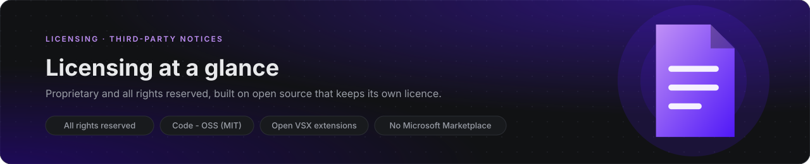
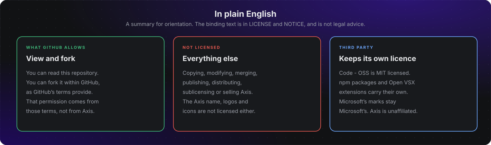

# Licensing at a glance

This page orients readers. The binding texts are [`LICENSE`](../LICENSE) and [`NOTICE`](../NOTICE) at the repository root, which stay as plain text so build tooling and the product metadata can point at them. Nothing here is legal advice, and the licence text still needs a legal review before the first distributed build.

## The Axis licence

Axis is **proprietary, all rights reserved**, copyright 2026 Dylan Lambertson. Publishing this repository is not a release of the software.

| You may | Source |
|---|---|
| View the repository and fork it within GitHub | GitHub's Terms of Service, which apply to every public repository |
| Read the documentation and the design decisions | Same |

You may not, without written permission:

- copy, modify, merge, publish, distribute, sublicense or sell Axis;
- reuse the Axis name, logos or icons;
- treat anything here as a licence grant beyond the two rows above.

Every Axis-owned source file starts with `Copyright (c) 2026 Dylan Lambertson. All rights reserved.` Upstream headers and third-party notices are kept untouched.

## Third-party software

| Component | Licence | How Axis uses it |
|---|---|---|
| [Code - OSS](https://github.com/microsoft/vscode) | MIT, Copyright (c) Microsoft Corporation | The base of the shell and IDE view. Axis applies reviewable patches, an overlay and replacement files, and keeps the upstream notices. The MIT text is reproduced in [`NOTICE`](../NOTICE). |
| npm packages | Each package's own licence | Installed at build time with exact version pins. A licence audit and an SBOM are planned under the supply-chain controls in [`SECURITY.md`](SECURITY.md#supply-chain-and-updates). |
| Open VSX extensions | Each extension's own licence | The extension registry. Axis does not offer the Visual Studio Marketplace. |

## Trademarks

"Visual Studio Code", "VS Code" and the Microsoft logos are trademarks of Microsoft Corporation and are not licensed here. Axis is not affiliated with or endorsed by Microsoft. Microsoft-licensed products such as the Visual Studio Marketplace, the proprietary remote extensions and Copilot are not part of Axis.

## Where the analysis lives

| Document | Covers |
|---|---|
| [`docs/feasibility/licensing-and-marketplace.md`](feasibility/licensing-and-marketplace.md) | The licence, trademark, marketplace and telemetry constraints on a Code OSS product |
| [`docs/adr/0002-code-oss-integration-strategy.md`](adr/0002-code-oss-integration-strategy.md) | The integration decision and the licensing consequences |
| [`docs/design/axis-shell.md`](design/axis-shell.md) | How the notices and the Axis licence reach the built artifacts |

