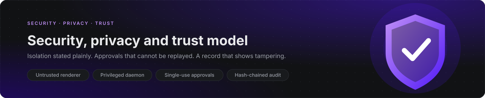
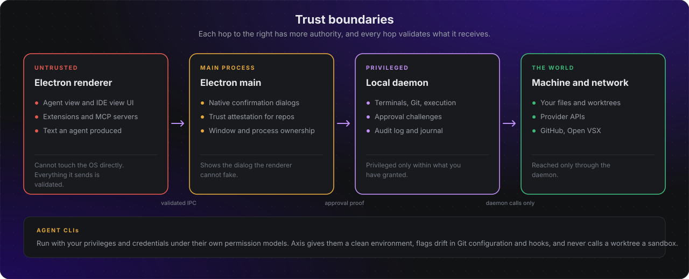
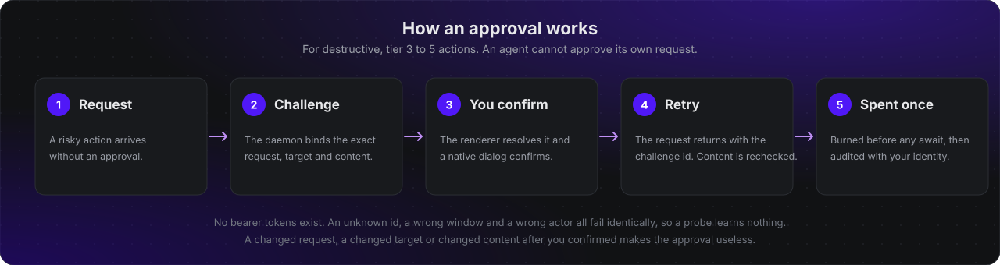

# Security, Privacy and Trust Model

## Threats
Prompt injection from source files and external tools; malicious extensions; compromised provider credentials; shell command abuse; cross-Space or cross-project data leakage; supply-chain dependencies; malicious agent patches; cloud runner breakout; collab impersonation; sync key loss; model exfiltration.

## Boundaries
Electron renderer is untrusted relative to local OS; validate all IPC. Local daemon is privileged only within user grants. Extensions and MCP servers are third-party code and require trust boundaries. Agents execute in restricted subprocess/container environments with resource quotas and egress policies. Git worktrees prevent edit collisions but are **not security sandboxes**.

## Approvals and policy
Default deny for destructive file operations outside approved worktree, network egress, package install, credential reads, Git pushes, remote commands, deployments and elevated privileges. Policy engine evaluates actor, workspace, tool, scope, target, side effect and organization rule. Audit approval identity and expiration. Prevent self-granted permissions.

## Secrets
OS credential store on desktop; managed encrypted vault for cloud. Scoped handles to tools; never inject all credentials into agent prompts or process environment. Redact logs and error reports. Support revoke/rotate and provider-specific access scopes.

## Local/cloud data
Clear consent before transmitting source code, prompts or embeddings to third parties. Show provider and data destination. Local-first indexing by default. Sync opt-in, encrypted in transit and at rest; E2EE only when key sharing/recovery/rotation has been designed and tested. Organization data residency as future enterprise capability.

## Identity and collaboration
OIDC/OAuth for product login where supported, device sessions, MFA/passkeys as feasible, RBAC plus resource-level authorization, invitation lifecycle, revocation, signed audit records. Never trust client-side role checks alone.

## Supply chain and updates
Pinned dependencies, SBOM, license audit, signed builds, update signatures, vulnerability scanning, Code OSS upstream security patch plan, reproducible CI where possible. Validate extension distribution and marketplace licensing separately.

## Testing
Threat model per major milestone; security integration tests, path traversal/symlink escapes, command injection, SSRF/egress, prompt injection, privilege escalation, tenant isolation, race conditions, secrets redaction, offline revocation edge cases, cloud runner containment.

