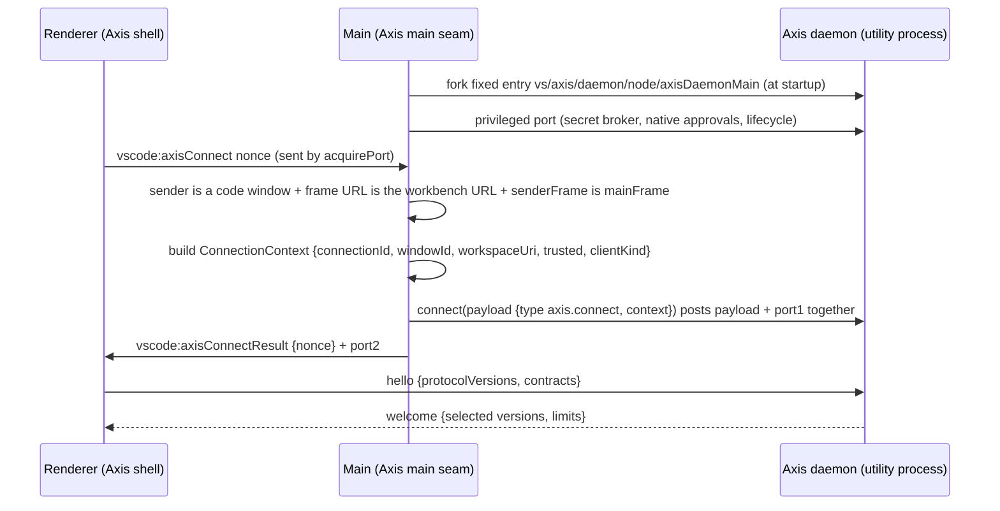

# ADR 0003: Electron IPC bridge for Axis services

- **Status:** Proposed. Becomes Accepted after the Phase 1 bridge spike meets the validation criteria below.
- **Date:** 2026-11-01.
- **Depends on:** ADR 0002 (Code OSS integration strategy, Proposed): Axis shell code in `src/vs/axis`, no deep upstream patches, decision 6 (Copilot and agent host removal as a separate patch set) and decision 7 (security-hardening patch range).
- **Related:** `docs/security/threat-model-phase0.md`. Threat IDs such as EL-2 and DMN-1 refer to that document.
- **Upstream baseline:** Code OSS `1.144.0`, commit `2c33b50`. Paths starting with `src/`, `build/` or `remote/` are upstream paths at that commit. **[V]** = verified in source; **[I]** = inferred, not verified.

## Context

Axis-owned renderer code (the shell layer and leaf views under `src/vs/axis/**/browser`) needs to reach privileged Axis services:

- **Axis daemon (planned):** policy engine, tool broker, run journal and audit, provider gateway, worktree manager, context index.
- **Main process:** a secret broker, because Electron `safeStorage` is used from main (`src/vs/platform/encryption/electron-main/encryptionMainService.ts:6`) [V]; native approval prompts; process lifecycle.
- **Web target:** the same services, reached from the browser through the `reh-web` server.

### How upstream does it

1. **Preload.** It exposes a `vscode` global through `contextBridge` (`src/vs/base/parts/sandbox/electron-browser/preload.ts:252`) [V].
   - `ipcRenderer` send, invoke, on, once and removeListener accept only channels prefixed `vscode:` (`:16-17,110-147`) [V].
   - `ipcMessagePort.acquire` forwards a `MessagePort` from main into the page after a nonce match (`:149-166`) [V].
2. **Main side.** `validatedIpcMain` checks the `vscode:` prefix, the `VSCODE_AUTHORITY` host and the main frame (`src/vs/base/parts/ipc/electron-main/ipcMain.ts:106-148`) [V]. It skips those checks for empty or `about:blank` sender URLs (`:119`) [V].
3. **Channels.** Most services are multiplexed over `vscode:message` channels registered on `mainProcessElectronServer` (`src/vs/code/electron-main/app.ts:1386-1532`) [V]. Many of them are built with `ProxyChannel.fromService`, which calls any function-valued property by name with unvalidated arguments (`src/vs/base/parts/ipc/common/ipc.ts:1196-1210`) [V].
4. **Utility processes.** These get direct MessagePorts: the pty host through `vscode:createPtyHostMessageChannel` (`src/vs/platform/terminal/electron-main/electronPtyHostStarter.ts:44,124`) [V], and the shared process similarly.
   - The utility side is `Server` in `src/vs/base/parts/ipc/node/ipc.mp.ts:57-90` [V].
   - The renderer side is `acquirePort` in `src/vs/base/parts/ipc/electron-browser/ipc.mp.ts:37` [V].
5. **Connection context is client-asserted.** `IPCServer` takes the first message on a connection as its `ctx` (`ipc.ts:849-857`), and `IPCClient` sends whatever context it was constructed with (`ipc.ts:1020-1024`) [V].
6. **Cancellation.** The upstream IPC protocol already carries it (`RequestType.PromiseCancel`, `ipc.ts:42,61`) [V].
7. **Remote server.** Channels are registered on a socket server whose context is `RemoteAgentConnectionContext { remoteAuthority, clientId }` (`src/vs/server/node/serverServices.ts:130`; `src/vs/platform/remote/common/remoteAgentEnvironment.ts:37-40`) [V].

**Important fact (threat model §4.1).** The upstream renderer already holds user-equivalent authority: `localFilesystem`, `localPty`, `encryption`, `nativeHost`, and utility-process spawning with a renderer-chosen module (`app.ts:1406,1433,1464,1501,1532`) [V].

So the bridge cannot make a fully compromised renderer harmless. Its goals are narrower:

- Do not widen the renderer's authority.
- Keep Axis-specific authority (credentials, agent execution, approvals) out of the renderer.
- Make the daemon the single enforcement point.
- Resist the realistic attackers: confused-deputy calls from extensions, webviews and prompt-injected agent output (threat model EXT-2, EL-4, DMN-3).

### Invariants this ADR must honour

From `SECURITY.md`, `ARCHITECTURE.md`, `AGENT_SYSTEM.md` and ADR 0002:

- **I1** The renderer is untrusted. Validate all IPC on the receiving side.
- **I2** Default deny. A method without a policy rule is refused.
- **I3** No self-granted permissions. Prompt text, agent actors and the renderer cannot mint grants.
- **I4** Secrets are never sent to the renderer or placed in agent prompts or environments. Only scoped handles are.
- **I5** Typed, versioned RPC with cancellation, backpressure, idempotent operations and bounded retries.
- **I6** Every stage emits auditable events with redacted payloads.
- **I7** Shell code lives in `src/vs/axis`. Upstream edits are minimal, marked and counted against the ADR 0002 shell-layer budget (criterion 2: ≤ 12 files, ≤ 300 lines).
- **I8** Desktop and web share contracts. Shared code must not assume Node.

## Options

### Option 1: Axis channels on upstream `mainProcessElectronServer`

Implement Axis services in the main process and register them as `IServerChannel`s next to upstream's channels (`app.ts` `initChannels`).

- **For:** smallest new mechanism; reuses the `vscode:message` multiplexing as is; one upstream seam.
- **Against:**
  - Privileged logic and long-running work (agent scheduling, journal writes, provider streaming) would run in the most privileged, UI-critical process, and a crash takes the app down.
  - Web parity requires a second implementation.
  - It encourages `ProxyChannel.fromService`, which exposes whole service objects without validation.

### Option 2: a separate Axis namespace (`axis:` channels and a `window.axis` global)

Add a second preload (or patch `preload.ts`) exposing `window.axis`, and widen `validateIPC` and `validatedIpcMain` to accept an `axis:` prefix.

- **For:** clear separation in logs and code review.
- **Against:**
  - It patches the two most security-sensitive upstream files. Those are hot code, so rebase risk is high (I7).
  - It adds a second `contextBridge` surface to audit.
  - It brings no isolation benefit over Option 3, and none on the web.

### Option 3: a main-brokered MessagePort to an Axis daemon utility process

Use upstream's existing utility-process MessagePort pattern (as the pty and shared processes do) with an Axis contract layer on top.

- **For:**
  - No preload or `ipcMain.ts` patches. The handshake uses a `vscode:`-prefixed channel.
  - Privileged logic runs outside main and the renderer, with crash isolation.
  - The same contract layer can be served over the reh socket on the web.
- **Against:** a new process to manage; one more hop for latency; the daemon must not trust the upstream `ctx` (fact 5 above).

| Criterion | Option 1 | Option 2 | Option 3 |
|---|---|---|---|
| Upstream patch footprint | 1 seam (`app.ts`) | `preload.ts` + `ipcMain.ts` + main seam | `app.ts` + reh `serverServices.ts` + build entry |
| New renderer-visible surface | Channels on the existing bus | New global + channel prefix | One handshake channel + one port |
| Where enforcement runs | Main | Main | Daemon (main asserts identity) |
| Crash and performance isolation | None | None | Yes |
| Web parity | Second implementation | Second implementation | Same contracts, different transport |
| Rebase risk | Low | High | Low |

## Decision (proposed)

Adopt **Option 3**. The details follow.

### D1. Topology and handshake



1. Main forks the daemon at startup with a **fixed** entry point, through upstream `utilityProcess` support (`src/vs/platform/utilityProcess/electron-main/utilityProcess.ts`) [V]. *As built (X1):* the seam calls Electron's `utilityProcess.fork` directly, because the `UtilityProcess` class injects `VSCODE_*` variables and the `bootstrap-fork` entry; see `docs/design/daemon-host-entry.md`.
   - It is **never** launched through the renderer-reachable `UtilityProcessWorker` channel, whose `moduleId` the renderer chooses (`app.ts:1532`) [V].
   - The daemon opens **no listening socket or port** in Phases 1–3 (threat model DMN-4).
2. The handshake channel is `vscode:axisConnect` / `vscode:axisConnectResult`. The `vscode:` prefix passes upstream validation with no patch. The renderer uses upstream `acquirePort`, which sends only the nonce (`src/vs/base/parts/ipc/electron-browser/ipc.mp.ts:51`) [V]. Protocol versions and contract lists are negotiated in the first message on the port (`hello`/`welcome`), not in the handshake.
3. Before brokering, the main seam applies its own checks. It must not rely on `validatedIpcMain`, which returns early for empty and `about:blank` sender URLs (`ipcMain.ts:119-121`) [V]:
   - **Window identity (required).** `IWindowsMainService.getWindowByWebContents(event.sender)` must return a code window whose loaded config is an Axis workbench. This lookup returns only code windows (`src/vs/platform/windows/electron-main/windowsMainService.ts:1833-1841`) [V]. **It is the check that rejects auxiliary windows**: they open at `about:blank` (`app.ts:597-605`), load `preload-aux.ts`, which can send on any `vscode:` channel, and in them `senderFrame` is the main frame (threat model EL-3).
   - **Frame URL.** `event.senderFrame.url` must be the expected workbench URL on `VSCODE_AUTHORITY`. `about:blank` and empty URLs are rejected.
   - **Main frame.** `event.senderFrame === event.sender.mainFrame`, kept as defence in depth.
   - Per-window rate limits.
4. **Identity is bound to the port, not the payload.**
   - Main sends `ConnectionContext` to the daemon together with the port in one message, the way upstream's `UtilityProcess.connect(payload)` posts a payload and a port together (`utilityProcess.ts:397-402`) [V]. Only main can post on the daemon's `process.parentPort`.
   - The daemon reads `process.parentPort` directly. It does **not** use upstream's utility-side `Server` / `IPCServer` (`src/vs/base/parts/ipc/node/ipc.mp.ts:57-91`) or its `IClientConnectionFilter` hook, because `IPCServer` would build a `ChannelServer` from the client-asserted `ctx` (fact 5).
   - The daemon ignores any context the renderer sends, and any identity fields in payloads (threat model DMN-2).
5. Workspace scope comes from main's view of the window (`workspaceUri`, Workspace Trust state). A renderer cannot target a workspace that another window has open.
6. A **privileged main↔daemon port**, which no renderer can reach, carries:
   - `secrets.decrypt(handle, purpose)`. The daemon gets the plaintext and never forwards it.
   - `approvals.confirmNative(digest)`. Main shows `dialog.showMessageBox`.
   - Lifecycle messages.
7. **Web.** The reh server runs the daemon logic in a child Node process and registers **one** upstream channel, `axis`, on its socket server. That channel only tunnels Axis envelopes.
   - Identity is the authenticated reh connection: the single-user connection token (threat model WEB-1). The tunnel channel ignores the client-asserted `RemoteAgentConnectionContext`.
   - Phase 5 replaces this with gateway-issued user identity. The contracts do not change.
8. **Transport.** The desktop uses the upstream `Protocol` MessagePort framing (`src/vs/base/parts/ipc/common/ipc.mp.ts:42`) [V] with the Axis envelope below. It does **not** use upstream `IPCServer` or `ChannelServer` on the desktop, because their `ctx` is client-asserted (fact 5) and `call` has no validation hook. On the web the one tunnel channel is an upstream `IServerChannel` (D1.7), but it only carries envelopes into the same Axis pipeline.

### D2. Contracts, versioning and runtime validation

- **One contract per service.** Each contract has a stable ID and a major version (for example `axis.runs/1`). Each method declares:
  - its request, response and error schemas;
  - its `kind` (`call`, `stream` or `event`);
  - its `sideEffect` (`none`, `read`, `write`, `network`, `destructive` or `credential`) and its permission tier (`AGENT_SYSTEM.md`);
  - `timeoutMs`, `idempotency` (`none`, `optional` or `required`), and per-field `sensitivity` used for redaction.
- **Evolution.**
  - Within a major version, changes are additive only: new optional fields and new methods.
  - Removing or retyping anything requires a new major version, and the daemon serves N and N-1 for at least one release.
  - The handshake negotiates versions; an unknown method yields `E_METHOD_NOT_FOUND`.
  - **Recorded pre-release exception (2026-11-05, P1d):** `axis.worktrees/1.finalise` moved from `write`, tier 2 to `destructive`, tier 4 with an `approval` field, inside major version 1. No client has shipped and every in-repo caller was updated in the same change, so no N-1 was served. Once 1a ships, a tier or side-effect change is a new major version (or a policy raise, which never lowers). See `docs/design/worktrees-tier4.md`.
- **Validation is authoritative in the daemon.** Every request is checked in this order:
  1. A hand-written **envelope check** (about 100 lines, no library) runs before any schema work: maximum message size (default 1 MiB, lower per method), maximum depth, known envelope keys, and string length limits.
  2. **Payload schema:** strict objects, so unknown keys are rejected.
  3. **No automatic URI revival.** Upstream revives URIs unless marshalling is disabled (`ipc.ts:1200-1205`) [V]. URIs are passed as `UriComponents` and checked against a scheme allow-list.
  4. `__proto__`, `constructor` and `prototype` keys are rejected.
- **Client-side validation of responses** runs in dev and test builds only. It catches contract drift; it is not a security control.

**Schema library: Zod 4, through an Axis facade (`src/vs/axis/base/common/schema.ts`).**

| Candidate | Status at the pin | For | Against |
|---|---|---|---|
| **Zod 4** | Already a production dependency: `zod ^4.4.3` (`package.json:173`, `remote/package.json:56`), locked at 4.4.3 [V] | No new dependency and **no `package.json` or lockfile patch**, which would conflict on every weekly sync. MIT. Type inference. JSON Schema export for tool contracts and MCP [I]. A tree-shakable `zod/mini` entry for renderer bundles; 4.4.3 exports `./mini`, is MIT and has no dependencies [V, npm registry metadata]. | Its JIT uses `new Function`, which needs `'unsafe-eval'` and conflicts with Trusted Types in the renderer; it must run with `jitless: true` there [I, verify in M3]. Upstream's only non-test consumer is the agent host (`src/vs/platform/agentHost/node/claude/clientTools/claudeJsonSchemaToZod.ts`) [V]. That code is what Copilot removal deletes (VSCodium's removal patch does), so after ADR 0002 decision 6 Zod is an orphaned upstream dependency that upstream could drop. The decision 6 patch set must not remove it along with the agent host. |
| Valibot | Not present | Smallest bundle; modular | A new dependency means a patch to `package.json` and the lockfile; JSON Schema export is a separate package |
| TypeBox | Not present | JSON-Schema-native | A new dependency; a single maintainer |
| Ajv | Dev-only v6 (`package-lock.json:5578-5583`, `"dev": true`) and nested under the MCP SDK [V] | JSON Schema standard | Code generation through `eval`; large; not available at runtime without a dependency change |
| Hand-written | n/a | No dependency | Axis would own a security-critical parser and duplicate type definitions |

Consequences of choosing Zod:

- Contracts import only the facade. The decision 6 patch set keeps `zod` as a direct dependency even when it unbundles or deletes the agent host (its only upstream consumer). If upstream drops Zod, Axis either adds it in the patch series (one `package.json` line plus the lockfile) or vendors it under `src/vs/axis/base/common/vendor/`. Only the facade changes.
- Renderer bundle cost is measured in the M3 spike. No number is assumed here.

### D3. Call semantics

- **Envelope.** Each request carries `{ v, id, contract, method, idempotencyKey?, timeoutMs?, payload }`.
- **Cancellation.**
  - The client sends `{ cancel: id }`. Cancellation is cooperative: handlers receive a `CancellationToken`, and the tool broker escalates from SIGTERM to SIGKILL on the process group after a grace period.
  - When a port closes (window closed or crashed), all of that connection's in-flight calls are cancelled. Runs owned by the daemon continue and can be re-attached.
- **Timeouts.**
  - The server enforces the smaller of the contract `timeoutMs` and the client value. The client cannot raise it.
  - Calls are short (the default ceiling is 30 s). Anything longer returns an `operationId` and reports progress through a `stream` subscription. This avoids holding RPCs open for agent runs.
- **Idempotency.**
  - Methods marked `required` reject requests without an `idempotencyKey` (UUIDv4).
  - The daemon stores `(actorId, contract, method, key) → {payloadHash, result}` in the SQLite journal for 24 h.
  - A replay with the same payload returns the stored result. The same key with a different payload returns `E_IDEMPOTENCY_CONFLICT`.
  - Retries are bounded, with jitter, and only for errors marked `retryable`.
- **Backpressure.** Per-connection limits on in-flight calls and stream buffers. Overflow returns `E_BACKPRESSURE`, and dropped stream events are counted, not silently lost.
- **Structured errors.**
  - Errors have the shape `{ code, message, retryable, correlationId, details? }`.
  - `code` is drawn from a closed set: `E_INVALID_ARGUMENT`, `E_UNAUTHENTICATED`, `E_POLICY_DENIED`, `E_APPROVAL_REQUIRED`, `E_NOT_FOUND`, `E_CONFLICT`, `E_IDEMPOTENCY_CONFLICT`, `E_TIMEOUT`, `E_CANCELLED`, `E_BACKPRESSURE`, `E_UNAVAILABLE`, `E_METHOD_NOT_FOUND`, `E_VERSION_UNSUPPORTED`, `E_INTERNAL`.
  - `message` is user-safe and redacted. Stack traces never cross the bridge in built products.

### D4. Policy hook and approvals

Every request runs through one pipeline in the daemon, with no bypass path:

```text
envelope check → contract lookup → schema validate → identity (ConnectionContext)
  → policy.evaluate → [approval] → execute → audit
```

- **`policy.evaluate`** receives `{ actor, connection, workspace, contract, method, sideEffect, tier, target, scope }`.
  - `actor` is `user` (renderer-originated), `agent:<runId>/<taskId>` (from the tool broker) or `system`.
  - It returns `allow`, `deny` or `requireApproval(challenge)`.
  - When no rule matches, it denies (I2).
  - Rules come from the user and workspace policy store. Contracts declare the minimum tier, and the policy can raise it but never lower it.
- **Approvals are challenge-based (I3).**
  - `requireApproval` returns a daemon-issued `challengeId` bound to a digest of the request.
  - The renderer can display the challenge, but resolving it requires `approvals.resolve(challengeId, decision)` from an actor of kind `user`. Agent actors calling any `approvals.*` mutation get `E_POLICY_DENIED`.
  - For tiers 4–5 (destructive operations, credentials, push, deploy, elevated privileges), the daemon also requires `approvals.confirmNative` over the privileged main port. Main shows a native dialog with the digest, which a compromised renderer or an extension cannot click or overlay (threat model EL-4).
  - Grants record approver identity, scope, target pattern and expiry (`SECURITY.md`), and are always bound to a run.
- **No privileged commands.**
  - Axis does not register commands in `CommandsRegistry` that perform side effects. Commands may only open Axis UI.
  - This keeps the extension API (any extension can execute any command) from becoming a path into the daemon (threat model EXT-2).

### D5. Audit and redaction

- **What is audited:** every policy decision, approval resolution and side-effecting execution.
- **Record shape:** `{ ts, correlationId, actor, connectionId, workspaceId, contract, method, decision, tier, targetSummary, outcome, prevHash, hash }`, appended to `audit_events` (`IMPLEMENTATION.md`).
- **Integrity.** The daemon is the only writer. The hash chain gives local tamper evidence; it does not stop an attacker with the user's privileges.
- **Payloads are not logged by default.** `targetSummary` is derived from fields annotated `sensitivity: 'public' | 'path'`.
- **Redaction.** Fields marked `secret` are never logged, and fields marked `content` are logged as a length plus a hash. A secret-pattern scanner runs over all log sinks as a second layer (threat model DMN-6).

### D6. Placement and upstream footprint

```text
src/vs/axis/
  base/common/schema.ts                     facade over zod (zod/mini in common code)
  platform/protocol/common/                 envelope, errors, contract definitions (no Node imports)
  platform/protocol/electron-browser/       renderer client (uses upstream acquirePort)
  platform/protocol/node/                   daemon RPC server, envelope check, policy pipeline
  code/electron-main/axisMainSeam.ts         daemon launch, handshake, secret broker, native approvals
  daemon/node/axisDaemonMain.ts              daemon entry
  server/node/axisRemoteChannel.ts           reh tunnel channel
```

Upstream edits, marked `// --- Start Axis ---` / `// --- End Axis ---`:

| File | Edit | Estimated lines |
|---|---|---|
| `src/vs/code/electron-main/app.ts` | Import and start `axisMainSeam` after `initChannels` | ≤ 6 |
| `src/vs/server/node/serverServices.ts` | Register the `axis` tunnel channel | ≤ 4 |
| `build/next/index.ts` | Add the daemon entry point to the hard-coded esbuild entry list (inventory §1) [V that the list is hard-coded]. This file is already one of the shell files in inventory §9(b). | ≤ 2 |
| `eslint.config.js` | `local/code-import-patterns` targets for `src/vs/axis/~` and the `code/electron-main`, `daemon/node` and `server/node` sub-layers, modelled on the `src/vs/sessions/~` target (`eslint.config.js:2289`) [V] | ≤ 40 |

That is four files and about 52 lines in total, counted against the ADR 0002 shell-layer budget (criterion 2). Two of them (`app.ts`, `serverServices.ts`) are new to the shell file list, which leaves little file headroom under the 12-file limit.

The upstream security-hardening patches proposed in the threat model (web CSP, reh cookie, `openExternal`) are not bridge seams. They belong to the separate range in ADR 0002 decision 7 and are not counted here. There are no edits to `preload.ts`, `ipcMain.ts` or CSP files for the bridge itself.

### D7. Prohibited patterns

The `src/vs/axis` lint configuration should reject:

- `ProxyChannel.fromService` or `ProxyChannel.toService` for Axis services;
- new `contextBridge` globals or channel prefixes;
- secrets, tokens or raw credential values in any contract response schema (a schema-level `secret` sensitivity is forbidden in responses);
- renderer-supplied identity fields (`actor`, `workspaceId` used as authority);
- Axis services registered on `mainProcessElectronServer`.

## Interface sketches (illustrative, not implementation)

```ts
// src/vs/axis/platform/protocol/common/contract.ts
export type SideEffect = 'none' | 'read' | 'write' | 'network' | 'destructive' | 'credential';
export type Tier = 1 | 2 | 3 | 4 | 5; // AGENT_SYSTEM.md permission tiers
export type Sensitivity = 'public' | 'path' | 'content' | 'pii' | 'secret';

export interface MethodSpec<Req, Res> {
  readonly kind: 'call' | 'stream';
  readonly request: Schema<Req>;           // facade type over zod
  readonly response: Schema<Res>;
  readonly sideEffect: SideEffect;
  readonly minTier: Tier;
  readonly timeoutMs: number;               // server-enforced ceiling
  readonly idempotency: 'none' | 'optional' | 'required';
  readonly sensitivity?: Readonly<Record<string, Sensitivity>>; // JSON-pointer → class
}

export interface ContractSpec {
  readonly id: `axis.${string}`;
  readonly major: number;
  readonly methods: Readonly<Record<string, MethodSpec<unknown, unknown>>>;
}

// Example: a contract with one idempotent, side-effecting method.
export const RunsV1 = defineContract({
  id: 'axis.runs', major: 1,
  methods: {
    start: method({
      kind: 'call', sideEffect: 'write', minTier: 2, timeoutMs: 5_000, idempotency: 'required',
      request: s.object({ goal: s.string({ max: 20_000 }), modelRef: s.optional(s.string({ max: 200 })) }),
      response: s.object({ runId: s.id(), operationId: s.id() }),
      sensitivity: { '/goal': 'content' },
    }),
  },
});
```

```ts
// src/vs/axis/platform/protocol/common/envelope.ts
export interface AxisRequest {
  readonly v: 1;
  readonly id: number;                      // per-connection sequence
  readonly contract: string;                // 'axis.runs/1'
  readonly method: string;
  readonly idempotencyKey?: string;         // UUIDv4
  readonly timeoutMs?: number;              // may only lower the contract ceiling
  readonly payload: unknown;                // validated server-side
}
export type AxisResponse =
  | { readonly v: 1; readonly id: number; readonly ok: true; readonly result: unknown }
  | { readonly v: 1; readonly id: number; readonly ok: false; readonly error: AxisError };
export interface AxisCancel { readonly v: 1; readonly cancel: number }

export interface AxisError {
  readonly code: AxisErrorCode;             // closed set, see D3
  readonly message: string;                 // user-safe, redacted
  readonly retryable: boolean;
  readonly correlationId: string;
  readonly details?: { readonly challengeId?: string; readonly retryAfterMs?: number };
}
```

```ts
// Main-asserted identity; never parsed from renderer input.
export interface ConnectionContext {
  readonly connectionId: string;            // 128-bit random, minted by main
  readonly clientKind: 'workbench' | 'remote';
  readonly windowId?: number;               // desktop only
  readonly workspaceUri?: UriComponents;
  readonly workspaceTrusted: boolean;
}

// Daemon-side policy hook.
export interface PolicyRequest {
  readonly actor: { kind: 'user' } | { kind: 'agent'; runId: string; taskId: string } | { kind: 'system' };
  readonly connection: ConnectionContext;
  readonly contract: string; readonly method: string;
  readonly sideEffect: SideEffect; readonly tier: Tier;
  readonly target?: { kind: 'path' | 'url' | 'git-ref' | 'provider' | 'tool'; value: string };
}
export type PolicyDecision =
  | { readonly effect: 'allow'; readonly grantId?: string }
  | { readonly effect: 'deny'; readonly reason: string }
  | { readonly effect: 'requireApproval'; readonly challengeId: string; readonly native: boolean };
export interface IAxisPolicyEngine { evaluate(req: PolicyRequest, token: CancellationToken): Promise<PolicyDecision> }
```

## Consequences and tradeoffs

- **Positive:**
  - The renderer's authority does not grow: one handshake channel and one port.
  - Enforcement, audit and secrets stay outside the renderer and main.
  - Desktop and web share contracts.
  - The bridge footprint is about 4 files and 52 lines, with no changes to security-critical upstream IPC files.
- **Negative:**
  - A daemon process to supervise (restart, memory budget).
  - An extra hop: renderer → daemon is direct over the port, but secret use goes daemon → main → daemon.
  - The Axis envelope duplicates some upstream IPC features (cancellation, request IDs).
- **Residual risk (accepted for Phases 1–2):**
  - A fully compromised renderer still has upstream's `localPty` and `localFilesystem` (threat model PTY-1, R1). The bridge does not change that.
  - Removing those channels from the renderer is a separate, upstream-heavy decision, deferred.
- **Developer cost:**
  - Every method needs a schema, a side-effect class, a tier and sensitivity annotations. The contract definition is the review artifact for security review.

## Validation criteria (Phase 1 bridge spike)

1. The handshake works from the Axis shell on macOS and Linux, and is refused from:
   - a webview;
   - an `about:blank` auxiliary window (rejected by the window-identity check);
   - a code window whose frame URL is not the workbench URL;
   - a second window that targets the first window's workspace.
2. The envelope and schemas survive a fuzz run (random, oversized, deeply nested and prototype-polluting payloads) with no daemon crash and only typed errors.
3. Behaviour tests pass for: cancellation on port close; timeout ceilings the client cannot raise; idempotent replay; `E_IDEMPOTENCY_CONFLICT`.
4. A test extension that runs every Axis command produces no daemon side effects.
5. Zod runs under the desktop Trusted Types CSP in `jitless` mode with no violations, and the bundle delta is measured and recorded.
6. Web: the same contract test suite passes through the reh tunnel channel.
7. The upstream footprint is measured and recorded against the ADR 0002 shell-layer budget.

## Rollback

- **If the daemon utility process proves unworkable** (for example, native modules or lifecycle problems), host the same RPC server in main behind the same handshake. That is Option 1 with Axis contracts, not `ProxyChannel`. The contracts, policy pipeline and renderer client do not change.
- **If Zod becomes unavailable or unsuitable,** swap the implementation behind `schema.ts`.
- Until Phase 2 ships privileged services, rollback only removes the four bridge seams (D6) and `src/vs/axis/platform/protocol`.

## Open questions

1. Should the daemon outlive windows, or the app, to support background agent runs? If so, it needs a listening socket and the DMN-4 controls (a P3 decision).
2. Should tier-3 actions (network, package install) also require native confirmation, or is the renderer approval UI enough?
3. Should Axis also remove upstream's renderer-reachable `UtilityProcessWorker` channel (`app.ts:1532`)? The agent-host channels are already covered by ADR 0002 decision 6. This one is a footprint versus surface-reduction tradeoff, to be decided with M3.
4. How long should idempotency records and audit records be retained?
