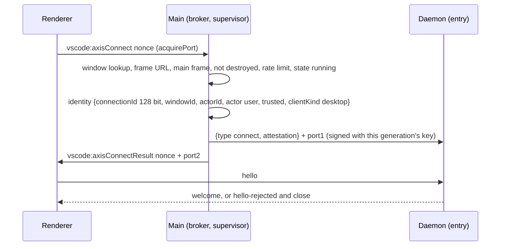

# Main's side of the control plane: the connect handshake and the answers (tickets X1b and X1c)

Companion to `docs/design/daemon-host-entry.md` (X1, merged), `docs/design/daemon-host.md` §3 step 6, §5.2, §5.4, §6.1 to §6.3, ADR 0003 D1 and validation criterion 1, and ADR 0005 D2 and D3. Evidence tags as in `daemon-host.md`: **[V]** verified in this repository or in the pinned Code OSS 1.144.0 tree; **[I]** inferred, not verified (on Linux nothing Electron runs: see "Verification").

The daemon side of every message below already exists and is fail closed (`src/control/client.ts`, `src/control/attestation.ts`, `src/storage/anchor-check.ts`, `src/gate/native-bridge.ts`, `src/handlers/cli-runs.ts`). This page defines what main does. Main is the only writer of the daemon's `parentPort` [V ADR 0003 D1.4], so main is where the user's authority (a window, a dialog, a trust decision, a setting) becomes a control message.

## 1. Where the code lives

| Piece | File | Runs in | Tested |
|---|---|---|---|
| Attestation signer (the canonical text and the MAC, no `@axis/*` import) | `packages/daemon-host/src/main/attest-sign.ts` | main | against the daemon's own verifier |
| Connect broker (sender checks, per-window rate limit, identity, connection id) | `packages/daemon-host/src/main/connect-broker.ts` | main | unit and child process |
| Supervisor: keeps the generation's key, signs and posts `connect` with a port | `packages/daemon-host/src/supervisor.ts` | main | unit |
| Answers (`anchor.get/put`, `native.confirm`, `trust.check`, `settings.get`) | `packages/daemon-host/src/main/answers.ts`, `main/native-queue.ts`, `main/settings-scope.ts`, `main/trust-model.ts` | main | unit and child process |
| Anchor store (record format, fail-closed read) and the durable file | `packages/daemon-host/src/main/anchor-store.ts`, `main/anchor-file.ts` | main | unit; the file on the real file system |
| Renderer client (hello/welcome, requests, cancel, close) | `packages/protocol/src/client.ts` | renderer | child process, against the real entry |
| Electron adapters (`ipcMain`, windows, `dialog`, `safeStorage`, configuration, trust storage) | `code-oss/overlay/src/vs/axis/code/electron-main/axisMainPorts.ts`, `axisMainSeam.ts` | main | source pins only (no Electron on Linux) |
| Renderer glue (`acquirePort`) | `code-oss/overlay/src/vs/axis/services/daemon/electron-browser/axisDaemonConnection.ts` | renderer | source pins only |

The `main/` files import nothing from the host but the control message schemas (`control/messages.ts`, already in main's graph through the supervisor; no compose, entry, index or minter) and no `electron`; only `anchor-file.ts` imports Node (`node:fs`, `node:path`, `node:crypto`; main is Node). Everything else that touches the world is injected, as in `supervisor.ts`. The renderer client lives in `@axis/protocol` (no `node:*`, the only package a renderer may import, ADR 0005 D2.2); this refines ADR 0005's table, where "renderer client" is overlay: the protocol logic moves into the package so it can be tested, and the overlay keeps the `acquirePort` glue.

## 2. X1b: the connect handshake

**Sender checks** (ADR 0003 D1.3, threat model EL-3), all required, in this order; the first failure refuses:
1. `nonce` is a string of 1 to 64 characters of `[A-Za-z0-9-]` (upstream sends a UUID [V `ipc.mp.ts:37`]).
2. `IWindowsMainService.getWindowByWebContents(event.sender)` returns a code window. This is the check that refuses auxiliary windows (they are not code windows) and webviews.
3. `event.senderFrame.url` is the window's workbench URL: scheme `vscode-file:`, host `vscode-app`, the path of `vs/code/electron-browser/workbench/workbench.html` (or `-dev.html` unbuilt) as main computes it with `FileAccess.asBrowserUri`; no query or fragment matters, `about:blank` and an empty URL never match. The sessions window URL does not match (it is not the Axis workbench).
4. `event.senderFrame === event.sender.mainFrame` (defence in depth).
5. The sender is not destroyed.
6. Per-window token bucket: burst 5, refill 10 per minute, at most 256 windows remembered (the oldest bucket of a closed window is dropped first; a full table refuses new windows rather than reset an exhausted bucket).
7. The supervisor is `running` (it saw `ready`; a degraded host is running and serves its audit reads). Otherwise refused with `not_ready`.

**Identity** (built by main, never read from the renderer): `connectionId` = 16 random bytes, base64url (22 characters); `windowId` = `w<id>` from the code window's numeric id; `actorId` = `local-user`; `actor` = `user` (main never brokers an `agent:*` or `daemon` identity for a renderer); `workspaceId` absent (a window is not bound to an Axis workspace; scope comes from the request and the daemon's journal); `trusted` = the window's Workspace Trust answer at connect time from the trust port, `false` when it cannot tell; `clientKind` = `desktop`.

**Signing.** The supervisor keeps a copy of the generation's key bytes from the spawn until that child's exit, a failed spawn or the stop, and zeroes it then. The key never leaves the supervisor: `connect(identity, port)` signs `HMAC-SHA256(key, canonicalJson(["axis.attest/1", identity, issuedAt]))` with the injected `hmacSha256` and `issuedAt` = the wall clock, and posts `{ type: "connect", attestation }` with exactly one transferred port. The canonical text is rebuilt in `attest-sign.ts` (main must not bundle `@axis/daemon`); a test signs random identities on both sides and requires byte-equal text and a verifier pass, so the two cannot drift. A restart makes a new key: every old port is closed by the old child's exit, and the renderer client reports `closed`, so the window reconnects (the renderer never sees a key).

**Refusal.** Main answers the renderer with upstream's error shape (`{ nonce, error: "<code>" }` on the result channel, closed codes only) and closes both ports. A refused sender gets no port. The daemon still verifies every attestation (MAC, 30 s age, 5 s skew, single use within the window, `identitySchema`); a forged or replayed `connect` is `hello-rejected` `E_UNAUTHENTICATED` and closed (daemon-host §6.1).

**Renderer client** (`AxisPortClient`): sends `hello` with the contracts it wants, accepts only a `welcome` that parses with the protocol schema, treats `hello-rejected` or a close as `rejected`, then sends request envelopes (ids `c<n>`; an idempotency key is the caller's, forwarded as given, never generated by the client), matches answers by id, parses each with `responseEnvelopeSchema` and the method's response schema, bounds waiting requests (64), sends `cancel` on abort and fails every pending call with a closed `E_UNAVAILABLE` on close. No text from the daemon becomes an error message.

## 3. X1c: the four requests (and `anchor.put`)

Rules for all of them: the supervisor parses every child message with `outboundMessageSchema` before main sees it, answers only the generation that asked (a stale child's message and a reply to it are dropped), and a handler that throws is no answer. Main's events are closed names with no value from a message (never a proof, a summary, a path or a setting value).

### 3.1 `anchor.get` and `anchor.put` (the audit anchor)

**Location.** `<base>/anchor/audit-anchor.v1`, where `<base>` is the D-3 base of `axisDataRoots` (the daemon's data directory is `<base>/daemon`, which main never writes and the anchor is never in). One anchor per data base: moving `XDG_DATA_HOME` or `LOCALAPPDATA` moves both. The directory is created `0700`, the file `0600`.

**Record.** `safeStorage.encryptString('axis.anchor/1 {"hash":"<64 hex>","seq":<n>}')`. Read back, the text must be exactly that form (strict: the tag, then canonical JSON with only `hash` and `seq`); anything else is `corrupt`.

**Read (once, before the first spawn).** The seam awaits `answers.prepare()` before `supervisor.start()`, so a keychain prompt cannot use up the host's 5 s budget (daemon-host §3 step 6). The result is one of:

| Store says | Main answers `anchor.get` | Host sees |
|---|---|---|
| a valid record | `anchor.result { anchor: { seq, hash } }` | its own check: ok, `database_behind_anchor`, `anchor_mismatch` or `audit_chain_invalid` |
| **the file does not exist** (`ENOENT` on the file only; the directory may be missing too) and the secure backend is available | `anchor.result { anchor: null }` | a first start on an empty chain; `anchor_missing` (degraded) if the database has events |
| the backend is not secure: `safeStorage.isEncryptionAvailable()` false, or Linux `getSelectedStorageBackend()` is `basic_text` or `unknown` | **no answer** | `anchor_unreachable` (degraded) |
| any other read error (permission, `EISDIR`, a symlink, I/O), a decrypt failure, a corrupt or unknown record | **no answer** | `anchor_unreachable` (degraded) |

So "no anchor" is said only when the record is definitively absent and could have been written securely. An unreadable record is never read as absent: that is the case that would let a deleted database plus a broken store look like a first start, and the host would replace the real anchor with a lower one. The host checks the chain itself, so even a `null` on a database with events is degraded (`anchor_missing`), never accepted.

**Write (`anchor.put { seq, hash }`).** Main acks `anchor.ack { seq }` only after the record is durable: temporary file `wx` `0600` in the same directory, write, `fsync`, close, `rename` over the record, `fsync` of the directory (POSIX; Windows has no directory handle to flush, `MoveFileEx` replace is used through `rename`). One write at a time; puts that arrive meanwhile are merged into the newest (an ack is cumulative). Refused, with no write and no ack (the host's anchor then stalls, tier 3 and above refuse, daemon-host §5.4):
- the store was unreadable or insecure at `prepare` (never overwrite a record main could not read);
- `seq` lower than the stored or pending anchor, or equal with another `hash` (a regression);
- a write that failed: main re-reads the store before it trusts its cache again (the next `anchor.get` answers from the re-read).
An equal `seq` and `hash` is acked without a write.

**What it does not protect against** (accepted, recorded for Q2 and Q3): a same-user attacker can delete both the database and the record (a reset that loses history and is visible: every project and workspace is gone); can restore an older record together with an older database copy (rollback: no monotonic counter exists that main could check); `safeStorage` is confidentiality, not an authenticated cipher on every platform (a bit-flipped record most likely fails the strict parse and is then unreadable, which is degraded). Linux without a keyring runs degraded until the consent design of Q3 exists. A main crash between the first record's temporary file and the rename leaves no record while the database has events, which starts degraded (`anchor_missing`); the exit is a reset of the data directory (Q2).

### 3.2 `native.confirm` (tier 4 and 5)

`{ challengeId, proof, windowId, summary }` -> main shows a modal dialog on the window `windowId` names (the broker's window table; a window that is gone, or never connected, is `confirmed: false`) and answers `native.result { challengeId, proof, confirmed, windowId }` with the same proof (the host checks it). The dialog port in the product is `dialog.showMessageBox(window, { type: "warning", message: "Axis needs your confirmation", detail: summary, buttons: ["Cancel", "Confirm"], defaultId: 0, cancelId: 0, noLink: true })`; `confirmed` is `response === 1` exactly. The summary is already display-safe (`displayTextSchema(192)` on the outbound schema).

Bounds: one dialog open at a time; at most 16 waiting (the host's `nativeWaitLimit` default); a duplicate `challengeId` while one waits is ignored; an entry that waited longer than 60 s (monotonic, the challenge TTL) is answered `false` without a dialog; an OPEN dialog is bounded by the same 60 s from the request's arrival: its `AbortSignal` (passed to `showMessageBox`) is aborted, which closes the box, the request is answered `false` (`expired`) and the next dialog opens, so one dialog left open cannot hold back every other window's confirmations and a late click is never applied; a dialog port that throws is `false`; more than 16 is `false`. `dispose()` answers nothing more. The proof is held only until the answer is sent and is never logged.

### 3.3 `trust.check` (TRU-2, per run start)

`{ requestId, windowId, workspaceId, projectId }` -> `trust.result { requestId, trusted }`. `trusted` is `true` only when ALL hold: the window is live in the broker's table; main knows the project's repository path (a project main registered: today none, see below); and that path is equal to or inside a URI the Workspace Trust model marks trusted. The model is the application-shared storage key `content.trust.model.key` [V `workbench/services/workspaces/common/workspaceTrust.ts:37,261`], `{ uriTrustInfo: [{ uri, trusted }] }`; only `file:` URIs count, comparison is per path segment after normalisation, case-insensitive on macOS and Windows. Anything else, or a port that throws, is `trusted: false`; the answer is synchronous (no wait), and the host treats silence the same. Paths compare without Unicode normalisation (an NFD path against an NFC folder is untrusted, failing closed) and, on macOS, case-insensitively as upstream's `extUri` does, even on a case-sensitive volume. `security.workspace.trust.enabled: false` does NOT make a repository trusted (decided conservatively; design question 2).

**Open item (review of X1c): the trust model is renderer-writable.** `content.trust.model.key` is written by the workbench in each renderer through the storage channel, so a compromised renderer (the EL-3 actor) can rewrite it. Today that reaches only the connection's `trusted` flag, which grants nothing on its own (a workspace grant needs a main `trust.set`, not built) and `trust.check`, which is always `false` (no project path, below). Moving main to a store renderers cannot write is not cheap here (upstream has no main-only trust store). So it is a gate line instead (ROADMAP Phase 1a "Trust enforcement", threat model TRU-2): before main registers projects, main must own the run-trust decision for Axis projects in a record only main writes, from a prompt main shows, and must not read the workbench model for it.

**Not built: main does not register projects yet** (`projects.register` from main is the remaining part of X1b in `daemon-host-entry.md`). Until it does, main knows no project path and every `trust.check` answers `false`, so every run start is refused `untrusted` (fail closed). The core takes a `projectPath(projectId)` lookup so registration only has to fill it.

### 3.4 `settings.get` (CFG-1)

`{ requestId, key }` with `key` in `axis.cliAgents`, `axis.git.runHooks` -> `settings.result { requestId, key, value }`. The settings port returns main's `IConfigurationService.inspect(key)`; `settings-scope.ts` picks `policyValue`, else `applicationValue`, else `userValue`, else `null`, and never reads `workspaceValue`, `workspaceFolderValue`, `memoryValue` or `defaultValue` (CFG-1; the host applies its own default to `null`). The value must be bounded JSON (the outbound schema of the host's inbound side); a value that is not, or a port that throws, is no answer (the host refuses on timeout and never falls back to a default). Main's configuration service reads the default profile's user settings only [I]: a window on another profile still gets the default profile's value (design question 3).

## 4. Audit and logs

The daemon audits what it decides (policy decisions, challenges, run starts, anchors through the chain). Main writes no audit rows: its answers are inputs the daemon records. Main logs closed event names with counts through the seam's logger: `connect_refused` with a closed reason (`bad_nonce`, `not_code_window`, `bad_frame`, `not_main_frame`, `destroyed`, `rate_limited`, `not_ready`), `anchor_unavailable` with a closed reason (`insecure_backend`, `read_failed`, `decrypt_failed`, `corrupt`), `anchor_put_refused` (`store_unreadable`, `regression`, `write_failed`), `native_refused` (`no_window`, `expired`, `queue_full`, `dialog_failed`), `trust_refused`, `settings_unanswered`. Never a value, a path, a proof or a summary.

## 5. Verification

On Linux (this ticket): every `main/` module, the supervisor and the renderer client by unit tests; the whole path by a child-process test that runs the real `runDaemonEntry` (with the test-only pty fakes; the production entry still passes no ports and refuses `pty_required`) under a parent that uses the real `DaemonSupervisor`, `ConnectBroker`, answers, anchor store and file (with a test cipher) and `AxisPortClient`. Node cannot transfer a `MessagePort` between processes, so the child's parent-port shim turns tunnelled frames into a real `MessageChannel` port before the entry sees it; the entry receives a transferred port exactly as under Electron.

Not verifiable here, for the Mac (and Windows): the overlay files type-check and run against real Electron (`ipcMain`, `getWindowByWebContents`, `senderFrame`, `MessageChannelMain`, `UtilityProcess.postMessage` with a transfer list, `dialog.showMessageBox` modality, `safeStorage` on each platform and its backend names, `IApplicationStorageMainService` readiness before the first `trust.check`, `IConfigurationService.inspect` in main), ADR 0003 validation criterion 1 (refusal from a webview, an `about:blank` auxiliary window, a code window with another frame URL), and that `acquirePort` receives the error shape main sends.

## 6. Design questions

1. A renderer reconnect after a daemon restart is the renderer's job (the client reports `closed`). Should main instead re-broker ports to every live window on `ready`?
2. `security.workspace.trust.enabled: false`: today runs stay refused. Should a user who disabled Workspace Trust be treated as trusting every repository (upstream semantics)?
3. Settings come from main's default profile. Should a window's own profile be used (that needs the window's profile id at `settings.get` time)?
4. Linux without a keyring (Q3): degraded until a consent flow exists. Acceptable for 1a?
