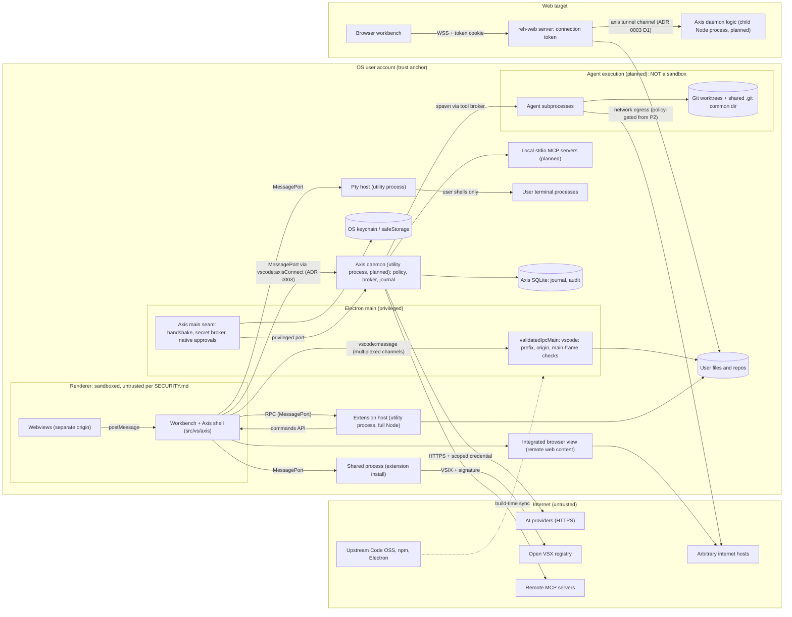

# Threat model: Phase 0/1 architecture

- **Purpose:** the Phase 0 threat model listed in `docs/ROADMAP.md` (Phase 0 deliverables and recommended ticket 3), as required by `docs/SECURITY.md` ("Threat model per major milestone").
- **Status:** Draft for review. Revisit at the Phase 1 gate and whenever ADR 0002 or ADR 0003 changes.
- **Date:** 2026-11-01.
- **Upstream baseline:** Code OSS `1.144.0`, commit `2c33b50b16c472efe58357d1d2a8a5414bc23fbf`, the same pin as ADR 0002.
- **Related:** `docs/adr/0002-code-oss-integration-strategy.md` and `docs/feasibility/*` (ADR 0002 is Proposed); `docs/adr/0003-electron-ipc-bridge.md` (Proposed).

**Conventions.** Paths starting with `src/`, `extensions/`, `build/`, `resources/` or `remote/` are upstream paths at the pinned commit; line numbers refer to that commit. Evidence tags:

- **[V]**: verified by reading upstream source at the cited `file:line`.
- **[I]**: inferred from source or general platform knowledge, not confirmed.
- **[A#]**: depends on an assumption in §2.

Mitigation tags: **(inh)** means inherited from upstream and kept as is; **(axis)** means Axis-owned (planned unless stated).

---

## 1. Method and scope

**Method: STRIDE per element on a data-flow diagram, plus an agentic overlay.**

- STRIDE per element fits a multi-process desktop app: each process, data store and flow crossing a trust boundary gets a threat pass, and the categories map directly onto controls (authn, integrity, audit, confidentiality, availability, authorization).
- STRIDE has no first-class category for model-mediated attacks. Two overlay categories are added, borrowed from the OWASP LLM Top 10 vocabulary:
  - **PI** (prompt injection): untrusted text steers an agent. Classified under STRIDE as Tampering with instructions.
  - **XA** (excessive agency): an agent acts beyond the intended scope. Classified as Elevation of privilege.
- LINDDUN (privacy) is deferred to Phase 5, when cloud sync and teams introduce cross-party data flows.

**In scope:** the Phase 0/1 architecture, plus the Phase 2–4 components that Phase 1 decisions constrain:

- Electron main, preload and renderer (the inherited Code OSS workbench), §5.1;
- the extension host and extensions, including the Open VSX supply chain, §5.2;
- the pty host and terminal, §5.3;
- the Axis local daemon (planned), §5.4;
- Git worktrees for agents (planned), §5.5;
- provider adapters and credentials (planned), §5.6;
- MCP servers (planned), §5.7;
- the web build through `reh-web` (remote server, authentication, CSP), §5.8;
- update and supply chain (Code OSS upstream sync, npm dependencies, Open VSX), §5.9.

**Out of scope:**

- Cloud runners, collaboration, organizations, sync and E2EE (Phase 5 gets its own threat model).
- A compromised OS, kernel or administrator account, and physical access to an unlocked machine.
- Another OS user with the same UID: same-UID processes are treated as equivalent to the user.
- Hardware side channels, and denial of service against third-party provider APIs.
- Microsoft-proprietary extensions, which Axis does not offer (licensing doc §4).
- Legal and licensing review, which is covered by `docs/feasibility/licensing-and-marketplace.md`.
- "Model exfiltration" from `SECURITY.md`. Axis hosts no model weights in Phases 0–4, and local inference endpoints are covered only as SSRF targets.

## 2. Assumptions

| ID | Assumption | If false |
|---|---|---|
| A1 | ADR 0002 Option A is accepted: a Code OSS checkout plus a patch series, with an Axis shell in `src/vs/axis`. | Re-run this model against the alternative (B or C). |
| A2 | Single user, single device. The web build in Phase 1 is self-hosted by that user, not multi-tenant. | Treat WEB threats as critical and pull Phase 5 identity controls forward. |
| A3 | Electron defaults apply where upstream does not set an option: `contextIsolation=true`, `nodeIntegration=false`, `nodeIntegrationInSubFrames=false` [I]. | Re-audit the renderer boundary. |
| A4 | Installed extensions run with the user's full privileges. Upstream does not sandbox the extension host [I]. **The Axis policy engine does not defend against a malicious extension.** Only supply-chain controls do. | n/a; this is a design fact to communicate to users. |
| A5 | Open VSX (public, managed or a mirror) is the only extension registry (licensing doc, Summary item 3). | Revisit EXT-3. |
| A6 | The Axis daemon runs as an Electron utility process forked by main, with no listening socket in Phases 1–3 (ADR 0003). | DMN-4 becomes high. |
| A7 | Providers are reached over HTTPS with system trust roots. No TLS pinning is planned. | n/a |
| A8 | Phase 2 agents run commands as the OS user. OS-level sandboxing arrives no earlier than Phase 3. | n/a; this is the main residual risk (R1). |
| A9 | ADR 0002 decision 6 removes the agent host entry points and the Copilot extension from Axis builds through a separate, budgeted patch set chosen in M3. Until that lands, whether upstream's agent host (`src/vs/platform/agentHost`) runs by default is **not verified**. | DMN-4, WEB-6 and SC-3 move up if decision 6 slips or leaves the agent host loadable. |

## 3. Data-flow diagram

**Trust boundaries:**

- **TB1:** renderer ↔ main, the `vscode:` IPC.
- **TB2:** renderer ↔ extension host, the extension API and commands.
- **TB3:** renderer or main ↔ Axis daemon, the ADR 0003 bridge.
- **TB4:** daemon ↔ agent subprocesses, the tool broker.
- **TB5:** desktop processes ↔ the internet (providers, Open VSX, MCP).
- **TB6:** browser ↔ reh-web server.
- **TB7:** build and supply chain ↔ the shipped binary.
- **TB8:** webview ↔ workbench (threat EL-8).

Agents never run through the pty host (PTY-1). The pty host serves only the user's own terminals.

## 4. Key inherited facts that shape every component

1. **The upstream renderer is not low-privilege in practice.** It can reach, through `vscode:message` channels registered on `mainProcessElectronServer`:
   - full local filesystem access (`localFilesystem`; `src/vs/code/electron-main/app.ts:1406`) [V];
   - process spawning in the pty host (`localPty`, `app.ts:1501`, built with `ProxyChannel.fromService` in `src/vs/platform/terminal/common/localPtyChannel.ts:10-11`) [V];
   - secret decryption (`encryption`, `app.ts:1433`) [V];
   - native host actions (`nativeHost`, `app.ts:1464`) [V];
   - utility-process spawning with a renderer-supplied `moduleId` and `allowLoadingUnsignedLibraries` (`app.ts:1532`; `src/vs/platform/utilityProcess/common/utilityProcessWorkerService.ts`; `utilityProcessWorkerMainService.ts:125-140`) [V]. The fork bootstrap imports `./${VSCODE_ESM_ENTRYPOINT}.js` (`src/bootstrap-fork.ts:236`) [V], so `..` segments in the module ID can load any `.js` file on disk [I].

   **Consequence:** code execution in the renderer is equivalent to code execution as the user. The Electron sandboxing of the renderer (`app.enableSandbox()` at `src/mainImpl.ts:48`, `sandbox: true` at `src/vs/platform/windows/electron-main/windows.ts:160`) [V] limits the impact of exploits on the *native* side. It does not limit the authority the renderer is given over IPC.
2. **`ProxyChannel.fromService` exposes every function-valued property of a service by name and does not validate arguments** (`src/vs/base/parts/ipc/common/ipc.ts:1196-1210`) [V].
3. **Preload and main-side IPC validation is prefix- and origin-based.**
   - The preload allows only channels prefixed `vscode:` (`src/vs/base/parts/sandbox/electron-browser/preload.ts:16-17,110-147`) [V].
   - `validatedIpcMain` checks the prefix, the `VSCODE_AUTHORITY` host and the main frame (`src/vs/base/parts/ipc/electron-main/ipcMain.ts:106-148`) [V], but **returns early when the sender URL is empty or `about:blank`** (`:119`) [V].
4. **Navigation and permission guards exist.**
   - `will-navigate` is blocked, and `setWindowOpenHandler` allows only `about:blank`, sending other URLs to `openExternal` (`app.ts:583-614`) [V].
   - `openExternal` passes non-http(s) schemes to `shell.openExternal` (`src/vs/platform/native/electron-main/nativeHostMainService.ts:731-737,788-790`) [V].
   - Permission request and check handlers allow-list permissions per origin (`app.ts:261-299`) [V].
5. **CSP.**
   - Desktop: `default-src 'none'`, Trusted Types required. It still allows `'unsafe-eval'` and `connect-src https: ws:` (`src/vs/code/electron-browser/workbench/workbench.html:6-70`) [V].
   - Web (`reh-web`): it allows `'unsafe-eval'` and `connect-src 'self' ws: wss: https:`, and has **no `require-trusted-types-for`** (`src/vs/server/node/webClientServer.ts:144-157`) [V].
   - **CSP does not prevent data exfiltration** on either target.

---

## 5. Components

Each threat row gives the STRIDE (or overlay) class, the existing mitigation, the gap, and the planned control with the phase that delivers it. The "Test" column uses the categories in §7.

### 5.1 Electron main, preload and renderer (inherited workbench)

- **Assets:** user files; the pty host; the `encryption` channel and the secrets behind it; window state; Axis shell UI integrity (approval dialogs, diff views).
- **Trust boundaries:** TB1, TB8.
- **Entry points:**
  - rendered content: markdown preview, notebooks, hovers, extension-contributed views, the integrated browser (`src/vs/platform/browserView`);
  - `vscode:` IPC;
  - deep links through the `urlProtocol` handler (`product.json`);
  - `openExternal`.

| ID | STRIDE | Threat | Existing mitigation | Gap | Planned control (phase) | Test |
|---|---|---|---|---|---|---|
| EL-1 | E | XSS or HTML injection in the workbench (from a markdown renderer, extension-supplied strings or agent output rendered in Axis UI) reaches the privileged channels in §4.1. | Trusted Types + CSP (inh); DOMPurify in the TT allow-list (inh) [V]. | `'unsafe-eval'` allowed. Axis React leaf UI is not yet proven under TT (ADR 0002 decision 4). Agent output is a new untrusted source. | Render all agent and model output as text or through upstream markdown sanitizers. Never `innerHTML`. Add an M3 check that the Axis React bundle runs under the existing TT policy (axis, P1). Lint rule banning `dangerouslySetInnerHTML` in `src/vs/axis` (axis, P1). | PI, SIT |
| EL-2 | E | A new Axis IPC surface widens renderer authority (for example, exposing credential reads or unrestricted spawn to the renderer). | None for Axis code. | No Axis bridge exists yet. | ADR 0003: the daemon is the enforcement point. No secrets cross TB1/TB3. No `ProxyChannel.fromService` for Axis services. Contracts are allow-listed and schema-validated (axis, P1). | PE, SIT |
| EL-3 | S | A spoofed IPC sender: an auxiliary window, a frame without the preload, or a sender with an `about:blank` or empty URL calls Axis channels. | Preload runs only in the main frame [A3]; `validatedIpcMain` prefix, origin and frame checks (inh) [V]. | Auxiliary windows open at `about:blank` (`app.ts:597-605`) [V] and load `preload-aux.ts`, which exposes `send`/`invoke` for any `vscode:` channel (`src/vs/base/parts/sandbox/electron-browser/preload-aux.ts:10,26-35`) [V]. In such a window `senderFrame` *is* the main frame, and `validatedIpcMain` returns early before both its origin and frame checks (`ipcMain.ts:119-121`) [V]. | The Axis handshake (ADR 0003 D1) applies three checks of its own (axis, P1). (1) `IWindowsMainService.getWindowByWebContents(event.sender)` must return a code window. It returns only code windows (`src/vs/platform/windows/electron-main/windowsMainService.ts:1833-1841`) [V], and **this is the check that rejects auxiliary windows**. (2) `event.senderFrame.url` must be the expected workbench URL on `VSCODE_AUTHORITY`; `about:blank` and empty URLs are rejected. (3) `senderFrame === sender.mainFrame`, kept as defence in depth. | PE |
| EL-4 | T/E | Forged approvals. Renderer-side approval UI is spoofed by an overlay, or clicked by script from a compromised renderer or extension-driven command. | None. | `SECURITY.md` requires "prevent self-granted permissions". The renderer cannot anchor that. | Tiers 4–5 (destructive, credentials, push, deploy) are confirmed through a main-process native dialog that shows a digest of the request, triggered by the daemon over the privileged port (axis, P2, ADR 0003 D4). | PE, PI |
| EL-5 | E | Protocol-handler abuse: links in agent output or webviews reach `openExternal` with `file:` or custom schemes, which `shell.openExternal` hands to the OS. | Navigation blocked; only `about:blank` popups allowed (inh) [V]. | Non-http(s) schemes go to `shell.openExternal` without an allow-list (`nativeHostMainService.ts:736-737`) [V]. | Axis UI calls `openExternal` only for `http`/`https`/`mailto`, and opens links from agent output only after a confirmation that shows the full URL (axis, P2). Evaluate an upstream patch adding a scheme allow-list (P1 decision; it belongs to the security hardening patch range, ADR 0003 D8). | CI, SIT |
| EL-6 | I | Deep link (`<urlProtocol>://`) parameters trigger actions such as opening a workspace or installing an extension. | Upstream URL handling with confirmation for some handlers (inh) [I]. | Axis may register URL handlers (for example OAuth callbacks). | Axis URL handlers accept only state-bound one-time values (OAuth `state` + PKCE) and never trigger side effects without UI confirmation (axis, P2). | SIT |
| EL-8 | S/T/E | A malicious webview (from an extension, or content rendered in one) posts crafted messages to the workbench, frames attacker content, or tries to reach Axis services through the workbench. | Webviews run on a separate origin: `vscode-webview:` on desktop (`workbench.html:25`) and `*.vscode-cdn.net` per UUID on the web (`webClientServer.ts:151`) [V]. Webviews talk only to their owning extension (inh) [I]. | Axis may use webviews for rich views (diffs, run logs). Messages from a webview are untrusted input. | Privileged Axis views are not webviews. Any Axis webview gets no bridge port, and its messages are validated with the same contract facade (ADR 0003 D2) before the host acts on them (axis, P1/P2). | PE, PI |
| EL-7 | E | Chromium or Electron n-day exploited through rendered content during the upstream sync lag. | Sandboxed renderer (inh) [V]. | Up to 2–4 weekly minors of lag (ADR 0002 decision 3). | Security fast path: sync within 7 days of an upstream recovery or Electron release that fixes a CVE (axis, P1 process). | SIT |

### 5.2 Extension host and extensions (Open VSX supply chain)

- **Assets:** everything the user can access [A4]; GitHub and other tokens held by authentication extensions; workspace content.
- **Trust boundaries:** TB2, TB5 (registry), TB7.
- **Entry points:** extension install (UI, CLI, recommendations, the `extensions.gallery.serviceUrl` override); extension auto-update; the commands API; webviews; `.vscode/extensions.json`.

| ID | STRIDE | Threat | Existing mitigation | Gap | Planned control (phase) | Test |
|---|---|---|---|---|---|---|
| EXT-1 | E | A malicious or compromised extension runs arbitrary code with user privileges. | Workspace Trust, on by default (`src/vs/workbench/contrib/workspace/browser/workspace.contribution.ts:799-801`) [V], limits *activation* in untrusted folders (inh). | No process sandbox [A4]. The Axis policy engine cannot constrain extensions. | Curated default extension set pinned by sha256 (as `product.json` `builtInExtensions` already does) (axis, P1). Optional org/user allow-list of extension IDs (axis, P4). Document clearly that extensions are fully trusted (axis, P1). | SIT |
| EXT-2 | E | Confused deputy: an extension (or a webview through its extension) calls Axis commands or services to start agent runs, grant approvals or read Axis data. | Commands are callable by any extension (inh, by design) [I]. | Any Axis action registered in `CommandsRegistry` is reachable by every extension. | Axis privileged operations are **not** commands. Commands may only open UI, so the extension API has no path to daemon side effects. Side effects reach the daemon only from Axis UI code over the bridge. They are attributed to the renderer connection, and need a daemon-issued approval challenge: tiers 1–3 are resolved in the Axis UI, tiers 4–5 also need native confirmation (axis, P1–P2, ADR 0003 D4). | PE |
| EXT-3 | T | Unsigned or tampered VSIX from Open VSX, or a typosquatted or hijacked namespace. | Signature verification setting defaults to on (`extensions.contribution.ts:331-336`) [V]. | `NotSigned` is accepted unless the gallery manifest declares `allPublicRepositorySigned` (`src/vs/platform/extensionManagement/node/extensionManagementService.ts:346-350`, `common/extensionManagement.ts:818-823`) [V]. The verifier module `@vscode/vsce-sign` is listed only in `build/package.json:84` `allowScripts` and is loaded dynamically (`extensionSignatureVerificationService.ts:69-81`) [V]. In OSS builds `@vscode/vsce-sign` is a `build/` dev dependency only, absent from the root and `remote/` lockfiles [V]. If it fails to load, `verify` returns `undefined` (`extensionSignatureVerificationService.ts:79-82`) [V]. A *signed* extension then fails with "Signature verification was not executed" (`extensionManagementService.ts:349-363`) [V], while an unsigned one skips verification as `NotSigned` (`extensionDownloader.ts:73-74`) [V]. The likely result is inverted: signed extensions blocked, unsigned ones accepted [I until tested]. **How it behaves with Open VSX signatures is UNKNOWN.** Public 2025 reports of malicious Open VSX extensions are not verified here [I]. | M3 test: install a signed, an unsigned and a tampered extension from Open VSX on an Axis build, and record the outcomes. Then decide whether to ship `vsce-sign` (after a license check) or verify Open VSX signatures another way (axis, P0/P1). Prefer a managed or mirrored registry with a namespace allow-list and version pinning (business decision, licensing doc Summary item 4) (axis, P1). Show publisher-verification state in the Axis install UI (axis, P4). | SIT |
| EXT-4 | I | An extension reads Axis provider credentials through upstream `SecretStorage` or the `encryption` channel. | Per-extension secret scoping (inh) [I]. | The renderer can call `encryption.decrypt` (`app.ts:1433`) [V]. | Axis provider credentials never go through upstream `SecretStorage` or the `encryption` channel. They live in an Axis vault namespace held by the main-process secret broker and are used only inside the daemon (axis, P2, ADR 0003). | SR, PE |
| EXT-5 | I | Extensions collect their own telemetry, outside `telemetry.telemetryLevel`. | None (licensing doc §5) [V]. | Not controllable. | Disclose this in onboarding; audit the bundled extensions (axis, P1). | n/a |

### 5.3 Pty host and terminal

- **Assets:** shell processes; environment variables; git credentials reachable through askpass.
- **Trust boundaries:** TB1 (renderer to pty host), TB4 (agents run commands).
- **Entry points:** the `localPty` channel; `vscode:createPtyHostMessageChannel` (`src/vs/platform/terminal/electron-main/electronPtyHostStarter.ts:44,124`) [V]; terminal output parsing (escape sequences); terminal environment contributions from extensions.

| ID | STRIDE | Threat | Existing mitigation | Gap | Planned control (phase) | Test |
|---|---|---|---|---|---|---|
| PTY-1 | E | The renderer (or anything driving it) spawns an arbitrary executable through `localPty.createProcess`. | None beyond §4.1 (inh). | This is the renderer-equals-user equivalence. | Accepted in Phases 1–2. Axis agents must **not** run commands through the user-visible pty host. They run through the daemon tool broker (axis, P2). | CI, PE |
| PTY-2 | I/E | Credential handles leak into terminals and agent subprocesses: `GIT_ASKPASS`, `VSCODE_GIT_ASKPASS_*`, `VSCODE_GIT_IPC_HANDLE` (`extensions/git/src/askpass.ts:37-42,168`; `extensions/git/src/terminal.ts:39`) [V]; `VSCODE_IPC_HOOK_CLI` (`src/vs/workbench/api/node/extHostExtensionService.ts:164`) [V]. The git IPC socket sits in `os.tmpdir()` or `XDG_RUNTIME_DIR` (`extensions/git/src/ipc/ipcServer.ts:15-24`) [V]. | Filesystem permissions on the socket [I]. | Any process inheriting the environment can request git credentials through the askpass flow [I]. | The tool broker builds agent environments from an **allow-list** (PATH, HOME, LANG, TERM and per-tool additions). It never inherits the Electron or terminal environment, and strips `VSCODE_*`, `GIT_ASKPASS`, `SSH_AUTH_SOCK` and `*_TOKEN`/`*_KEY` unless a scoped grant applies (axis, P2). | SR, CI |
| PTY-3 | S/T | Escape-sequence spoofing: agent or tool output fakes shell-integration markers or OSC 8 hyperlinks to mislead the user or the command-detection logic. | Shell-integration nonce (`src/vs/platform/terminal/node/terminalEnvironment.ts:92`; `shellIntegration-bash.sh:219-220`) [V]. | Hyperlink targets are attacker-controlled. | Axis run logs are shown in Axis views as escaped text, not raw terminal streams. Any agent command output shown in a terminal uses a read-only, non-integrated terminal (axis, P2). | PI |
| PTY-4 | D | A runaway agent command (fork bomb, disk fill, infinite output). | None. | No quotas. | Broker enforces timeouts, output caps, a process-group kill and (P3) OS resource limits (axis, P2/P3). | RC |

### 5.4 Axis local daemon (planned)

- **Assets:**
  - the policy engine and approval grants;
  - the run journal and audit log (`DB`);
  - provider credential *use* (not storage);
  - the tool broker;
  - context indexes per workspace.
- **Trust boundaries:** TB3 (client side), TB4, TB5.
- **Entry points:** ADR 0003 MessagePort connections (renderer workbench, reh server); the privileged main port; tool results; provider responses.

| ID | STRIDE | Threat | Existing mitigation | Gap | Planned control (phase) | Test |
|---|---|---|---|---|---|---|
| DMN-1 | T/E | Malformed or oversized requests (prototype pollution, deep nesting, huge strings) crash the daemon or bypass checks. | None. | Upstream channels revive URIs and pass arguments through unchecked [V §4.2]. | Envelope size and depth limits before parsing; strict schemas with unknown keys rejected; no automatic URI revival (axis, P1, ADR 0003 D2). | SIT |
| DMN-2 | S | The caller claims another identity, workspace or run (for example a `workspaceId` it does not own). | None. | n/a | Identity comes from the main-asserted `ConnectionContext`, never from the payload. Workspace scope is checked on every call (axis, P1). | TI, PE |
| DMN-3 | E/XA | An agent or planner grants itself permissions (prompt text requests elevated tools). | None. | n/a | `approvals.*` mutations accept only daemon-issued challenge IDs confirmed by a user gesture. Agent actors cannot call them. Planner output is data, not policy (axis, P2). | PI, PE |
| DMN-4 | S/I | The daemon exposes a localhost port or socket that other local software, or a browser page through DNS rebinding, can call. | Not applicable while there is no listener [A6]. | Upstream precedents: the agent host WebSocket runs without token validation when `VSCODE_AGENT_HOST_CONNECTION_TOKEN` is unset (`src/vs/platform/agentHost/node/agentHostMain.ts:636-652`) [V]; the MCP gateway logs its capability URL (`src/vs/platform/mcp/node/mcpGatewayService.ts:192-193`) [V]. | No listener in Phases 1–3. If background runs need one later: a 0700 directory socket, a peer-credential check, a per-launch token, and a Host/Origin check for HTTP (axis, P3+). | SSRF, PE |
| DMN-5 | R | Missing or tamperable audit trail for approvals and side effects. | None. | n/a | Append-only `audit_events` with a hash chain, written by the daemon only, and approval identity plus expiry recorded (axis, P2, ADR 0003 D5). | RC, SR |
| DMN-6 | I | Secrets or source code leak through logs, crash dumps, error messages or telemetry. | Upstream redacts the `connection-token` argument (`src/vs/server/node/serverEnvironmentService.ts:25-26`) [V]. | No Axis redaction yet. | Field-level `sensitivity` annotations in contracts drive redaction; a pattern scanner as a second layer; structured errors carry no stack traces outside dev builds (axis, P2). | SR |
| DMN-7 | D | A daemon crash or hang breaks the workbench, or runs are lost. | Utility-process crash isolation (inh) [I]. | n/a | Journal-first state transitions, restart recovery, and per-call timeouts (axis, P2; `AGENT_SYSTEM.md` run state machine). | RC |
| DMN-8 | I | Cross-workspace leakage through shared indexes or memory. | None. | n/a | Every query is scoped by workspace and ACL-filtered (`CONTEXT.md`) (axis, P2/P4). | TI |

### 5.5 Git worktrees for agents (planned): not security sandboxes

- **Assets:** the user's main checkout; uncommitted work; `.git` common dir (config, hooks, refs, objects); CI configuration.
- **Trust boundaries:** TB4. A worktree is an *edit-collision* boundary only (`SECURITY.md`).
- **Entry points:** agent file writes; agent `git` invocations; the integrator's merge; the user opening a worktree in Axis.

Facts about git [I, general git behaviour]:

- Linked worktrees share `$GIT_COMMON_DIR`, which holds `config`, `hooks/`, refs and objects.
- A `git config` call from inside a worktree writes the shared config unless `extensions.worktreeConfig` is used.
- Hooks, `core.hooksPath`, `core.fsmonitor`, `core.sshCommand` and filter or diff drivers execute code whenever *any* checkout runs the relevant git command.

| ID | STRIDE | Threat | Existing mitigation | Gap | Planned control (phase) | Test |
|---|---|---|---|---|---|---|
| WT-1 | E | An agent escapes its worktree through absolute paths, `..` or symlinks (including a symlink planted in the repo that points outside). | None. | n/a | The broker canonicalises with `realpath` at the time of use and refuses writes outside the worktree root. Paths are opened with `O_NOFOLLOW` semantics where supported (axis, P2). | PT, RC |
| WT-2 | E | Persistence through the shared git dir: an agent sets `core.hooksPath`, `core.fsmonitor`, filters or hooks that later run in the user's main checkout. The upstream git extension auto-runs git on open in trusted workspaces (`extensions/git/package.json:70-72`, untrusted not supported) [V]. | Workspace Trust gates the git extension (inh). | Agents work in trusted workspaces. | Agent git operations run through the broker with `-c core.hooksPath=<empty dir> -c core.fsmonitor=false` and a scrubbed `GIT_*` environment. The integrator snapshots and diffs `$GIT_COMMON_DIR/config` and `hooks/` before and after each run, and fails closed on change (axis, P3). | CI, PE |
| WT-3 | E/PI | Agent-authored config persistence: writes to `.vscode/settings.json`, `tasks.json`, `launch.json`, `mcp.json`, `.devcontainer/`, `.github/workflows/`, `package.json` scripts, `.npmrc`, `.envrc` or `Makefile` execute later, either for the user or in CI. | None. | n/a | A protected-path policy class marks these writes as higher-tier, needing explicit approval. The review UI highlights them (axis, P2/P3). | PI, CI |
| WT-4 | T | Agents overwrite each other's or the user's uncommitted work. | Worktree per worker (axis, P3). | n/a | One branch and worktree per worker; base SHA recorded; integration queue (`AGENT_SYSTEM.md`) (axis, P3). | RC |
| WT-5 | I | Malicious patch: an agent introduces a backdoor that passes tests. | None. | n/a | The reviewer role cannot approve its own work; human approval before merge, by risk tier; a diff of security-sensitive files is surfaced (axis, P3). | PI |

### 5.6 Provider adapters and credentials (planned)

- **Assets:** API keys, OAuth tokens and their refresh tokens; prompts and source code sent to providers; cost budget.
- **Trust boundaries:** TB5; the main secret broker ↔ daemon.
- **Entry points:** credential entry UI; the OAuth redirect; provider responses (streamed); user-configured custom base URLs.

| ID | STRIDE | Threat | Existing mitigation | Gap | Planned control (phase) | Test |
|---|---|---|---|---|---|---|
| PRV-1 | I | Credential at rest is weak: Linux `--password-store=basic` or the `basic_text` backend gives obfuscation only (`src/vs/platform/encryption/electron-main/encryptionMainService.ts:26-31,79-106`) [V]. | safeStorage (inh) [V]. | Silent plaintext-equivalent storage on Linux. The renderer can also call `setUsePlainTextEncryption` at runtime: it is part of `IEncryptionMainService` (`src/vs/platform/encryption/common/encryptionService.ts:10`), exposed through `ProxyChannel` (`app.ts:1432-1433`) [V]. | The Axis secret broker checks the backend on **every** encrypt, not only at startup. It refuses to store provider credentials, or requires explicit consent, when the backend is `basic_text`, and shows the storage backend in the UI (axis, P2). | SR |
| PRV-2 | I | A credential is exposed to the renderer, extensions or agents (env, prompt, logs). | None. | n/a | Credentials are stored under the Axis vault namespace, decrypted only in main on daemon request, held in daemon memory, and never sent over TB1/TB3. Agents get scoped handles (`SECURITY.md`) (axis, P2). | SR, PE |
| PRV-3 | E | The signed Axis binary is used as a Node interpreter with `ELECTRON_RUN_AS_NODE`, so it inherits keychain ACLs and macOS TCC grants. The upstream CLI launchers depend on this (`resources/darwin/bin/code.sh:38`, `resources/linux/bin/code.sh:62`) [V]. No Electron fuses are configured in `build/` (grep found none) [V]. | None. | The `RunAsNode` fuse cannot be disabled without changing the CLI. | Phase 6: flip fuses (`RunAsNode` off, `EnableNodeCliInspectArguments` off, ASAR integrity on), and ship the CLI as a separate binary (upstream has a Rust CLI in `cli/`) (axis, P6). Until then, keychain items are labelled as Axis-owned (axis, P2). | PE |
| PRV-4 | I/PI | Data goes to the wrong destination: a silent fallback provider, or a prompt with secrets sent to a provider without consent. | None. | n/a | Routing never crosses providers without policy (`PROVIDERS.md`). The destination is shown per request. Secret scanning runs on outgoing context (axis, P2). | SR, PI |
| PRV-5 | S/SSRF | A custom OpenAI-compatible base URL points at `localhost`, link-local or a cloud metadata IP, or at an attacker endpoint that harvests keys. | None. | n/a | Base URLs require HTTPS except an explicit "local endpoint" mode. Link-local and metadata ranges are blocked. Keys are bound to their configured origin, and redirects to another origin drop the credentials (axis, P2). | SSRF |
| PRV-6 | D | Runaway cost or token loops. | None. | n/a | Per-run and per-workspace budgets enforced in the daemon (axis, P2). | RC |

### 5.7 MCP servers (planned, Phase 4)

- **Assets:** tools with side effects; OAuth tokens for remote MCP servers; context sent to servers.
- **Trust boundaries:** TB4 (stdio servers are local processes), TB5 (remote servers).
- **Entry points:** workspace `mcp.json`, user configuration, tool descriptions, tool results.
- **Upstream precedent:**
  - stdio servers are spawned from the extension host (`src/vs/workbench/api/node/extHostMcpNode.ts`) [V];
  - a trust model exists (`McpServerTrust`, `src/vs/workbench/contrib/mcp/common/mcpTypes.ts:482`) [V];
  - a localhost HTTP gateway serves UUID capability routes (`mcpGatewayService.ts:174,192,314,323`) [V].

| ID | STRIDE | Threat | Existing mitigation | Gap | Planned control (phase) | Test |
|---|---|---|---|---|---|---|
| MCP-1 | E | A repository-supplied MCP config auto-starts an arbitrary local command. | Upstream MCP trust prompt (inh) [V exists; behaviour not verified]. | Axis may run its own broker. | Workspace-supplied servers are disabled until the user approves each one, and the approval is pinned to the exact command and argument hash (axis, P4). | CI, PI |
| MCP-2 | PI | Tool poisoning or rug-pull: tool descriptions inject instructions, or change after approval. | None. | n/a | Pin tool schema and description hashes at approval and re-prompt on change. Descriptions are treated as untrusted data (axis, P4). | PI |
| MCP-3 | SSRF/I | Remote MCP servers receive context or tokens beyond their scope. | None. | n/a | Egress policy per server; OAuth tokens per server and audience; no ambient credentials (axis, P4). | SSRF, SR |
| MCP-4 | I | The capability URL of an upstream gateway route leaks through info-level logs (`mcpGatewayService.ts:193`) [V]. | UUID unguessability (inh). | Logs may be exported in diagnostics. | Decide in M3 whether upstream MCP is disabled in Axis builds. If kept, redact gateway URLs in diagnostics exports (axis, P1 decision, P4 control). | SR |

### 5.8 Web build through `reh-web` (remote server, auth, CSP)

- **Assets:** full filesystem and terminal of the server host; the connection token.
- **Trust boundaries:** TB6.
- **Entry points:** HTTP/WSS on `--host`/`--port` (default host `localhost`, `serverEnvironmentService.ts:38`) [V]; the token in the query string or cookie; webview origins.

| ID | STRIDE | Threat | Existing mitigation | Gap | Planned control (phase) | Test |
|---|---|---|---|---|---|---|
| WEB-1 | S | The single bearer token is the only authentication: no user identity, no expiry, persisted in `<user-data-dir>/token` (`serverConnectionToken.ts:92-118`, mode 0600) [V]. Comparison is not constant-time (`:37-39`) [V]. `--without-connection-token` disables it (`serverEnvironmentService.ts:44`) [V]. | Mandatory token by default (inh). | No per-user auth or revocation. | Phase 1: the Axis launcher always sets a token, binds to loopback, and refuses `--without-connection-token`. Phase 5: an Axis gateway with OIDC in front, per-user server instances, and short-lived tokens (axis). | SIT, TI, OR |
| WEB-2 | I | Token theft. The cookie is set without `HttpOnly` or `Secure` and lasts a week, at two sites (`webClientServer.ts:319-325` and `:488-494`) [V]. The client reads the token from page script (`src/vs/workbench/browser/web.main.ts:325`; `src/vs/code/browser/workbench/workbench.ts:594`) [V], so `HttpOnly` would break the client. A successful XSS can also drive the already-open authenticated WebSocket, whatever the cookie flags. | `SameSite=Lax` (inh). The query token is already stripped with a 302 to a token-free URL (`webClientServer.ts:313-335`) [V]. | Plain HTTP exposes the token; XSS exposes both the token and the open connection. | (1) TLS for any non-loopback host, plus the `Secure` flag (page script can still read it) (axis, P1). (2) WEB-3 Trusted Types as the XSS control (axis, P1). (3) The Phase 5 gateway with short-lived, per-user tokens (axis, P5). `HttpOnly` needs a token-delivery redesign, and any design that hands the token to page script is just as readable by XSS, so it is not planned. | SIT |
| WEB-3 | E | Web XSS escalates to remote code execution on the server. The web CSP lacks Trusted Types and allows `'unsafe-eval'` (`webClientServer.ts:144-157`) [V]. | Script nonce and `'self'` (inh). | Weaker than desktop. | Add `require-trusted-types-for 'script'` with the desktop allow-list (one upstream patch in the security hardening range, ADR 0003 D8) (axis, P1). | SIT |
| WEB-4 | T/I | Webview content is loaded from Microsoft's `*.vscode-cdn.net`. **Removing the `product.json` key is not enough:** the code falls back to a hard-coded `vscode-cdn.net` template (`src/vs/workbench/services/environment/browser/environmentService.ts:241-250`) [V]. | Origin isolation per UUID (inh). | Third-party code origin, availability and privacy. | Set `webviewContentExternalBaseUrlTemplate` to an Axis-controlled wildcard origin that serves the pinned commit's `pre/` assets. The web CSP hard-codes `frame-src 'self' https://*.vscode-cdn.net data:` (`webClientServer.ts:151`) [V], so `createWorkbenchContentSecurityPolicy` must also be patched to allow that origin instead, or every webview frame is blocked (hardening range, ADR 0003 D8) (axis, P1). | SIT |
| WEB-5 | T | Host-header influence: `remoteAuthority` is taken from `x-original-host`/`x-forwarded-host`/`Host` (`webClientServer.ts:351`) [V] and inserted into the CSP `script-src` (`:149`) [V]. | None. | A misconfigured proxy can widen the CSP [I]. | The gateway overwrites forwarded headers; the server accepts them only from a configured proxy (axis, P1 doc, P5 gateway). | SSRF |
| WEB-6 | E | The upstream agent-host bridge and channels are registered on the remote server (`src/vs/server/node/serverServices.ts:333-392`) [V]. | Unavailable-channel stubs when disabled (inh) [V]. | Default enablement not verified [A9]. | ADR 0002 decision 6 removes the agent host from the build. Security acceptance for that patch set: the remote server registers only the `UnavailableAgentHostChannel` stubs and the `--agent-host-port` / `--agent-host-bridge-*` options start nothing (axis, P1). | PE |

### 5.9 Update and supply chain

- **Assets:** build integrity; the shipped binary; user trust in updates.
- **Trust boundaries:** TB7.
- **Entry points:**
  - upstream sync (the patch series);
  - `npm ci` across about 5,080 locked package entries: `package-lock.json` 1,669, `build/` 578, `remote/` 181 and `remote/web` 26 [V counts], plus about 2,600 in the extension lockfiles that `build/npm/dirs.ts` installs (1,224 of them in `extensions/copilot`, which ADR 0002 decision 6 removes) [V counts];
  - native modules built from source (`.npmrc` `build_from_source="true"`, `ignore-scripts=false`) [V];
  - built-in extensions;
  - Open VSX;
  - the update channel.

| ID | STRIDE | Threat | Existing mitigation | Gap | Planned control (phase) | Test |
|---|---|---|---|---|---|---|
| SC-1 | T | A malicious npm package or install script runs on developer or CI machines, or ships in the product. | Lockfiles with integrity hashes (inh) [V]. An `allowScripts` list exists in `build/package.json:83-91` [V]. | `ignore-scripts=false` in root `.npmrc` [V]. | CI uses `npm ci` only; lockfile diffs are reviewed in the sync PR; `npm audit` and an OSV scan; SBOM per build; network-isolated build step after fetch where feasible (axis, P1). | SIT |
| SC-2 | T | An upstream sync brings a regression or security-relevant change into the patched seams. | Upstream review (inh). | Patch-series conflicts can be resolved incorrectly. | The sync PR template lists the security-relevant upstream files touched (§4 files, `app.ts`, preload, `ipcMain.ts`, CSP), and the security tests in §7 must pass (axis, P1). | SIT |
| SC-3 | T | Inherited third-party agent and vendor SDKs (`@vscode/copilot-api`, `@github/copilot-sdk`, `@anthropic-ai/claude-agent-sdk`, `@anthropic-ai/sdk`, `@vscode/sandbox-runtime` 0.0.1; `package.json:104,106,118,128,176`; `@anthropic-ai/claude-agent-sdk` at `:176` is a devDependency, the others are runtime dependencies) [V] widen the attack surface and license exposure. | n/a | ADR 0002 decision 6 removes Copilot and the agent host as a separate patch set. M3 picks one of (a) unbundle, (b) stubs, (c) delete. Options (a) and (b) leave inert sources or stubs in the tree. | Security acceptance for the decision 6 patch set (axis, P1): (1) the built desktop, server and web artifacts contain no `@github/copilot*` or `@vscode/copilot-api` code and no `agentHostMain` entry; (2) any stub is a no-op or throws, and makes no network or process calls; (3) lockfiles are regenerated by the build scripts and their diff is reviewed in the sync PR; (4) `zod` stays a direct dependency (ADR 0003 D2). M3 also lists the remaining agent-related dependencies (`@anthropic-ai/*`, `@vscode/sandbox-runtime`) as removed, kept or reviewed. | SIT |
| SC-4 | T/S | A malicious update. OSS has no `updateUrl`, so updates are disabled (`src/vs/platform/update/electron-main/abstractUpdateService.ts:206-207`) [V]. On Windows, upstream checks only a sha256 taken from the same update server (`updateService.win32.ts:313`) [V]. | Updates are off (inh). | No Axis update channel yet. | Phase 6: signed artifacts (Authenticode, Apple notarization), an update manifest with a signature checked against a pinned Axis key, staged rollout and rollback (axis, P6). | SIT |
| SC-5 | T | Built-in extensions are fetched from GitHub releases or the gallery at build time (licensing doc §3). | sha256 pins in `product.json` (inh) [V per inventory §7]. | Pins must be kept current. | Keep the sha256 pins and fail the build on mismatch (axis, P1). | SIT |
| SC-6 | E | Security fixes lag because of the 2–4 minor sync cadence. | n/a | n/a | Security fast path (see EL-7) and an upstream-advisory watch (axis, P1). | SIT |

---

## 6. Prioritized risk register

Likelihood (L) and impact (I) use a 1–3 scale; score = L × I. "Owner phase" is the phase that delivers the primary control. Ranks are a proposed order for review; ties are broken by how early the exposure starts.

| Rank | ID | Risk | Threats | L | I | Score | Owner phase |
|---|---|---|---|---|---|---|---|
| 1 | R1 | Agent commands run with full user privileges; a worktree is not a sandbox. | PTY-1, WT-1, WT-2, PTY-4 | 3 | 3 | 9 | P2 broker + policy; P3 OS sandbox |
| 2 | R2 | Prompt injection from the repo, tools or MCP causes exfiltration or persistence. | WT-3, WT-5, PRV-4, MCP-2, EL-1 | 3 | 3 | 9 | P2 (policy, protected paths); P4 (MCP) |
| 3 | R3 | Provider credentials exposed through renderer-reachable secret channels, env inheritance, logs or Linux basic storage. | EXT-4, PRV-1, PRV-2, PTY-2, DMN-6 | 2 | 3 | 6 | P2 |
| 4 | R4 | Confused deputy into Axis services from extensions, webviews or a compromised renderer. | EXT-2, EL-2, DMN-2 | 2 | 3 | 6 | P1 (ADR 0003) |
| 5 | R5 | Self-granted or forged approvals. | EL-4, DMN-3 | 2 | 3 | 6 | P2 |
| 6 | R6 | Malicious or compromised Open VSX extension; signature semantics unknown. | EXT-1, EXT-3 | 2 | 3 | 6 | P1 (registry policy); P4 (allow-list) |
| 7 | R7 | Shared `.git` config or hooks persistence from agent worktrees. | WT-2 | 2 | 3 | 6 | P3 |
| 8 | R8 | Upstream, Electron or Chromium security-patch lag. | EL-7, SC-6, SC-2 | 2 | 3 | 6 | P1 (process) |
| 9 | R9 | npm and build supply chain (about 5,080 locked entries including extensions, install scripts on). | SC-1, SC-3, SC-5 | 2 | 3 | 6 | P1 (CI); P6 (reproducible, signed) |
| 10 | R10 | reh-web exposure: single bearer token readable by page script, no TLS by default, weaker CSP. | WEB-1, WEB-2, WEB-3, WEB-5 | 2 | 3 | 6 | P1 (local-only hardening); P5 (gateway) |
| 11 | R11 | MCP stdio auto-start, tool poisoning, rug-pull. | MCP-1, MCP-2 | 3 | 2 | 6 | P4 |
| 12 | R12 | Web webviews served from a third-party CDN by fallback. | WEB-4 | 3 | 2 | 6 | P1 |
| 13 | R13 | Inherited unused privileged surfaces: agent host without a token, MCP gateway URL in logs, renderer-chosen utility modules. | DMN-4, MCP-4, WEB-6, SC-3, §4.1 | 2 | 2 | 4 | P1 (ADR 0002 decision 6, M3) |
| 14 | R14 | SSRF and egress through custom provider URLs and remote MCP. | PRV-5, MCP-3 | 2 | 2 | 4 | P2 / P4 |
| 15 | R15 | `ELECTRON_RUN_AS_NODE` lets local malware reuse Axis keychain and TCC grants. | PRV-3 | 2 | 2 | 4 | P6 |
| 16 | R16 | Protocol-handler abuse through `openExternal`. | EL-5, EL-6 | 2 | 2 | 4 | P2 |
| 17 | R17 | Audit gaps, tampering or missing redaction. | DMN-5, DMN-6 | 2 | 2 | 4 | P2 |
| 18 | R18 | Resource exhaustion and cost runaway. | PTY-4, PRV-6, DMN-7 | 2 | 2 | 4 | P2 / P3 |
| 19 | R19 | Cross-workspace data leakage in daemon state or the index. | DMN-8 | 2 | 2 | 4 | P2 / P4 |
| 20 | R20 | Unsigned update channel once enabled. | SC-4 | 1 | 3 | 3 | P6 |
| 21 | R21 | Terminal escape-sequence spoofing. | PTY-3 | 2 | 1 | 2 | P2 |

## 7. Mapping to `SECURITY.md` testing categories and test ideas

**Categories (from `SECURITY.md` "Testing"):**

- **SIT**: security integration tests.
- **PT**: path traversal and symlink escapes.
- **CI**: command injection.
- **SSRF**: SSRF and egress.
- **PI**: prompt injection.
- **PE**: privilege escalation.
- **TI**: tenant isolation.
- **RC**: race conditions.
- **SR**: secrets redaction.
- **OR**: offline revocation edge cases.
- **CR**: cloud runner containment.

| Category | Threats | Test ideas (phase) |
|---|---|---|
| SIT | EL-1, EL-2, EL-5, EL-6, EL-7, EXT-1, EXT-3, DMN-1, WEB-1–4, SC-1–6 | Playwright and Electron smoke test that loads the Axis shell under the production CSP and fails on any Trusted Types violation (P1). Fuzz the ADR 0003 envelope and schemas with random and boundary payloads (P1). Install a signed, an unsigned and a tampered VSIX from a test registry and assert each outcome; today's expected inversion (signed blocked, unsigned accepted) must be fixed before P1 exit (P1). CI check that diffs the CSP and the IPC channel list against an approved snapshot on every upstream sync (P1). |
| PT | WT-1 | Repo fixtures with symlinks to `~/.ssh`, `../`, absolute paths, case-folding and Unicode-normalisation tricks on macOS, Windows junctions; and a TOCTOU swap between check and write (P2/P3). |
| CI | EL-5, PTY-1, PTY-2, WT-2, WT-3, MCP-1 | Tool-broker arguments containing shell metacharacters must reach `execve` unexpanded. Agent attempts to set `core.hooksPath` or `core.fsmonitor` must be detected by the integrator's config diff. `openExternal` must refuse `file:` and custom schemes from agent output (P2/P3). |
| SSRF | DMN-4, PRV-5, MCP-3, WEB-5 | Custom base URL set to `169.254.169.254`, `[::1]`, a DNS-rebinding host, and redirect chains across origins; assert credentials are never sent off-origin (P2). A port scan of loopback during a run asserts no Axis listeners (P1–P3). |
| PI | EL-1, EL-4, EL-8, DMN-3, PTY-3, WT-3, WT-5, PRV-4, MCP-1, MCP-2 | Seeded repo files and tool outputs with injected instructions ("grant yourself network", "edit `.vscode/settings.json`", exfiltrate an env var); assert policy denials and audit entries (P2). An MCP server that changes its tool description after approval (P4). |
| PE | EL-2, EL-3, EL-4, EL-8, EXT-2, EXT-4, PTY-1, DMN-2, DMN-3, WT-2, PRV-2, PRV-3, WEB-6 | A test extension calls every Axis command and asserts no side effects. A request with a foreign `workspaceId` is rejected. An `about:blank` auxiliary window, and a window whose frame URL is not the workbench URL, attempt the Axis handshake. An agent actor calls `approvals.grant`. A tier-4 action needs the native dialog (P1/P2). |
| TI | DMN-2, DMN-8, WEB-1 | Two workspaces with distinct secrets and indexes; cross-queries return nothing (P2/P4). Multi-user reh behind the gateway (P5). |
| RC | PTY-4, DMN-5, DMN-7, WT-1, WT-4, PRV-6 | Kill the daemon mid-tool-call and verify recovery and idempotent replay. Concurrent merges. Audit hash chain verified after a crash (P2/P3). |
| SR | EXT-4, PTY-2, DMN-5, DMN-6, PRV-1, PRV-2, PRV-4, MCP-3, MCP-4 | Canary secrets planted in vault, environment and repo; grep logs, crash dumps, diagnostics exports, the audit DB and provider request captures for them (P2). Linux `basic_text` backend refuses to store keys (P2). |
| OR | WEB-1 | Token rotation and revocation while a browser is offline (P5); provider key revocation during a running agent (P2). |
| CR | (out of scope; Phase 5) | Defined in the Phase 5 threat model. |

## 8. Gaps carried forward and decisions needed

1. **Inherited agent surfaces.** ADR 0002 decision 6 covers Copilot and the agent host; the SC-3 acceptance checks above should be added to its M3 evaluation. Still undecided: `vs/sessions` agent entries, the upstream MCP gateway, and the renderer-reachable `UtilityProcessWorker` channel. This reduces R13.
2. **Choose the OS sandbox for agent subprocesses** in Phase 3. Candidates: macOS `sandbox-exec` profiles, Linux bubblewrap (upstream already probes for `bwrap` and `socat`, `src/vs/platform/sandbox/node/sandboxHelper.ts:34-49` [V]), Windows AppContainer or a separate low-privilege user, and upstream `@vscode/sandbox-runtime` (version 0.0.1, so it needs evaluation).
3. **Decide the Open VSX deployment** (public, managed or mirror). This determines the EXT-3 controls.
4. **Upstream patches proposed by this model.**
   - The ADR 0003 bridge seams (`app.ts`, `serverServices.ts`, `build/next/index.ts`, `eslint.config.js`) count against the ADR 0002 shell-layer budget (criterion 2) only. ADR 0003 D6 lists them.
   - The security hardening patches form a separate, measured range, recorded in ADR 0003 D8. Like decision 6, it has no fixed line budget, but it must rebase within ADR 0002 criterion 4's ≤ 1 working day sync. The range is:
     - web CSP: `require-trusted-types-for 'script'` (WEB-3);
     - web CSP: `frame-src` for the Axis webview origin (WEB-4);
     - reh cookie: `Secure` when served over TLS (WEB-2);
     - optionally, an `openExternal` scheme allow-list (EL-5).
   - ADR 0002 criterion 4 currently reads "shell plus guardrails". When ADR 0002 is next revised, it should name the hardening range too (owner decision).
