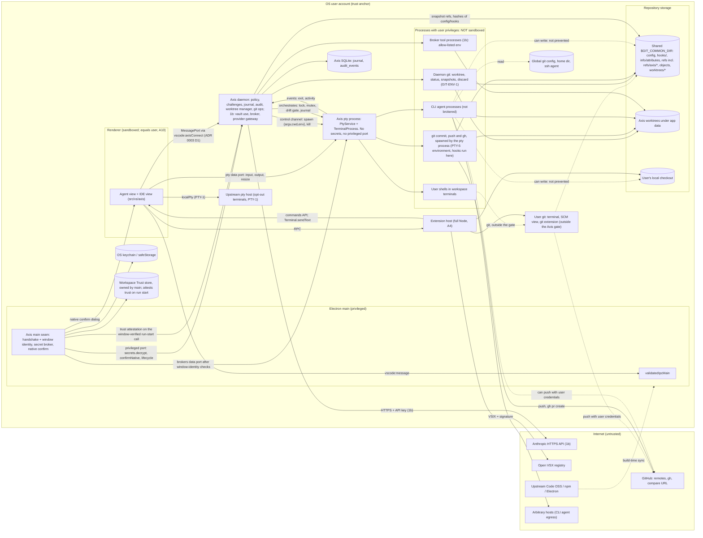

# Threat model: Phase 1 (agent-first shell, 1a and 1b)

- **Purpose:** the threat-model revision that ADR 0004 (security implication 7) requires before the Phase 1a gate, for the agent-first architecture.
- **Status:** Draft for review.
- **Date:** 2026-11-02.
- **Relationship to Phase 0.** `docs/security/threat-model-phase0.md` is kept unchanged as history. Its threat IDs stay valid. This document does three things:
  - it adds the new threats and controls (§4);
  - it replaces the Phase 0 text for every row it marks **changed**, and re-tags owner phases (companion file §8);
  - it inherits every row it does not mention (§4.10 lists them).

  Where the two documents disagree on a row that this one marks changed, this one wins.
- **Companion file:** `docs/security/threat-model-phase1-controls.md` holds the control-to-gate matrix, gate gaps, residual risks, the re-tag table, the risk register and open questions (§5 onward). It is split out to keep both files under 500 lines.
- **Upstream baseline:** Code OSS `1.144.0`, commit `2c33b50b16c472efe58357d1d2a8a5414bc23fbf` (as Phase 0).
- **Sources:** ADR 0003, ADR 0004, `docs/design/axis-agent-shell.md` ("design"), `docs/design/axis-agent-shell-policies.md` ("policies"), `docs/ROADMAP.md`, `docs/SECURITY.md`, `docs/PROVIDERS.md`, `docs/feasibility/prototype-*.md`.

**Conventions.**

- Evidence tags: **[V]** verified by an existing Axis document at the cited `file:line` (upstream paths at the pin). **[V, new]** verified for this document in the pristine tree at the pin. **[I]** inferred, including general `git` behaviour, and not confirmed. **[D]** a claim about Axis design taken from the design documents; it is a plan, not code.
- Mitigation tags: **(inh)** inherited, **(axis)** Axis-owned. Phases are 1a, 1b or later (P2 and up).
- "Gap" means the planned control, as written in the design documents, does not yet cover the threat. Gaps are numbered G-n and collected in the companion file §6 and §7.

---

## 1. Scope and assumptions

**In scope (Phase 1, desktop):**

- the Agent view shell and the IDE view in one window;
- the Axis daemon (worktree manager, challenges, journal, audit; vault, broker, provider gateway in 1b);
- the Axis pty process and workspace terminals;
- CLI agent runs (1a) and composer runs (1b);
- Axis-run `git` and `gh`;
- snapshot refs under `refs/axis/*`;
- Workspace Trust inheritance;
- the Open VSX supply chain as it affects 1a and 1b;
- the Anthropic HTTP adapter.

**Out of scope or deferred (unchanged from Phase 0 unless stated):** cloud runners, teams and sync (Phase 5); a compromised OS or another same-UID process; the OS sandbox for agents (Phase 3); MCP (Phase 4); the web build. ADR 0004 and the design move the browser skeleton to Phase 2, so the Phase 0 `WEB-*` rows move to P2. reh-web is still packaged in the builds, so that holds only while it is not started (NET-1, §4.9).

| ID | Assumption | If false |
|---|---|---|
| A1–A7, A9 | As Phase 0. | As Phase 0. |
| A8 (**changed**) | Agents run commands as the OS user **from Phase 1a**. CLI agents (1a) are not brokered at all. Composer agents (1b) are limited by the broker's policy, not by the OS. | n/a; this is the main residual risk (R1, R22). |
| A10 | Renderer equals user (Phase 0 §4 fact 1) still holds. Anything Axis decides in the renderer is advisory. Enforcement lives in the daemon and in main. | Re-audit every "renderer asks, daemon checks" flow. |
| A11 | CLI agents are user-installed binaries launched through their documented interfaces under the user's own login. Axis sees only the process, the pty stream and the worktree. It cannot see what a CLI does or why. | n/a |
| A12 | `git` behaves as in the facts of Phase 0 §5.5 and as stated in the design (shared common dir, gitfile worktrees, hooks, `core.hooksPath`). Not re-verified here [I]. | Re-run the WT-2, GIT-SNAP-1 and GIT-4 fixtures against the real `git`. |
| A13 | Security-relevant `axis.*` settings (`axis.cliAgents`, `axis.terminals.scrubEnvironment`, `axis.git.runHooks`, `axis.worktrees.root`) are user, application or machine scope (never workspace or folder). **Decided** (owner decision on Q-3); workspace and folder values are ignored with a warning. | Repo-supplied settings can weaken Axis defaults (CFG-1). |

## 2. Data-flow diagram

**Trust boundaries.** TB1–TB3 and TB5–TB8 are as Phase 0 §3. Phase 1 changes or adds:

- **TB4a (composer broker, 1b):** daemon to broker tool processes. Policy, approvals, allow-listed environment, caps.
- **TB4b (new, 1a): daemon-launched pty to CLI agent process.** There is no policy, no approval and no audit behind it. The boundary exists only as environment scrubbing (PTY-5), a snapshot and review.
- **TB9 (new): daemon ↔ Axis pty process**, and renderer ↔ pty process data port. The pty process holds no secrets; the daemon never forks shells.
- **TB10 (new): shared `$GIT_COMMON_DIR` and the user's local checkout.** Every writer (CLI, user, daemon git) can reach it. It is the persistence channel between "isolated" worktrees and the user's own work.
- **TB11 (new): Axis ↔ GitHub and git remotes**, with the user's credentials, driven by the daemon (commit and push, `gh`) or by a CLI agent.

---

## 3. What changed since Phase 0, in one paragraph

Phase 0 assumed agents are brokered by a daemon with an allow-listed environment. In Phase 1a the first agents are **user-installed CLIs that Axis does not broker**. The load-bearing controls therefore move from "prevent" to "scrub the editor's secrets, observe, snapshot, and put a human review in front of every change". Phase 1b adds the brokered composer, where prevention is real but limited to what the broker mediates. Every residual risk in the companion file §7 follows from that split.

## 4. Threats and controls

Columns: ID, class (STRIDE or the PI and XA overlays of Phase 0 §1), threat and gap, control with phase, test category (Phase 0 §7). New classes: **DR** (data loss from concurrent writers), **CFG** (configuration injection).

### 4.1 Terminals, the Axis pty process and CLI agent runs

- **Assets:** the user's credentials reachable from a shell (`SSH_AUTH_SOCK`, credential helpers, git config); the local checkout and shared common dir; the vault (1b, held in the daemon, not here).
- **Entry points:** daemon spawn requests; the pty data port; terminal output; extension API (`createTerminal`, `sendText`); `axis.cliAgents` settings.

| ID | Class | Threat and gap | Control (phase) | Test |
|---|---|---|---|---|
| PTY-1 (**changed**) | E | The renderer can still call `localPty.createProcess` on the upstream pty host (Phase 0 §4 fact 1, accepted). Phase 1 adds: workspace terminals and CLI runs live in the **separate Axis pty utility process** [D, design §4.4]. **Decided (Q-1): the design wins.** ADR 0004 implication 7 says CLI agents run in the "user-visible pty host"; that wording is a listed doc-fix item (controls §11.2), not edited here. The upstream pty host serves only opt-out terminals (`axis.terminals.scrubEnvironment: false`). | Accepted while renderer equals user. Axis runs CLI agents only through `axis.cli-runs/1.start`, which checks the worktree (DMN-2). It cannot stop the renderer from spawning a shell elsewhere. UI copy never claims it can (axis, 1a). | CI, PE |
| PTY-2 (**retag 1b**) | I/E | As Phase 0: broker tool processes must not inherit editor or terminal secrets. Applies **only to broker tool processes** (1b), not to terminals. | Allow-list: `PATH`, `HOME`, `LANG`, `TERM` and declared per-tool additions (axis, 1b). | SR, CI |
| PTY-3 (**changed**) | S/T | Agent or CLI output forges terminal escape sequences. The shell-integration addon loads on **every** terminal (`xtermTerminal.ts:339-340`) [V] and OSC 633 `P` `Cwd=` is accepted **without** the nonce; the addon only marks it untrusted. `ShellIntegrationAddon._updateCwd` still records it (`shellIntegrationAddon.ts:584-589,652-657`; `cwdDetectionCapability.ts:13,34-37`) [V, new], and a grep of `workbench/contrib/terminal` found no consumer of `CwdDetection.isTrusted` [V, new]. So a CLI can set the detected cwd. With `terminal.integrated.splitCwd: inherited`, that cwd would steer where a split pane opens [V, policies §5]. OSC 8 hyperlink targets are attacker-controlled. | (1) Splits always open in the worktree root through `ICreateTerminalOptions.cwd` (axis, 1a). (2) Command decorations in CLI terminals are presentation only; Axis derives no status from marks (axis, 1a). (3) Composer output is escaped text in Axis views, or a read-only, non-integrated terminal (axis, 1b). (4) Links from agent output go to `openExternal` only after a confirmation that shows the full URL, for `http`, `https` and `mailto` (EL-5). | PI, CI |
| PTY-4 | D | Unchanged. Broker timeouts, output caps, process-group kill (1b). CLI runs: stop sends SIGINT, SIGTERM, SIGKILL to the process group [D, design §4.5]. A CLI is otherwise unbounded (no quota, no budget). | As design §4.5 (axis, 1a for stop; 1b for broker caps). | RC |
| PTY-5 (**new**) | I/E | A CLI agent or user terminal inherits editor-injected secrets and handles: `GIT_ASKPASS`, `VSCODE_GIT_ASKPASS_*` (including `VSCODE_GIT_ASKPASS_NODE`, the signed Axis binary, the PRV-3 vector), `VSCODE_GIT_IPC_HANDLE`, `VSCODE_IPC_HOOK_CLI`, `SSH_ASKPASS*`, `GIT_EDITOR`, extension environment collections (`extensions/git/src/terminal.ts:28-40`, `askpass.ts:37-48`, `gitEditor.ts:30-33`, `terminalEnvironment.ts:295`) [V, ADR 0004]. | Deny-list applied **last**, over the daemon-built environment: drop `VSCODE_*`, `ELECTRON_*`, `GIT_ASKPASS`, `SSH_ASKPASS*`, `GIT_EDITOR`, the git redirectors and config injectors (`GIT_DIR`, `GIT_WORK_TREE`, `GIT_COMMON_DIR`, `GIT_INDEX_FILE`, `GIT_OBJECT_DIRECTORY`, `GIT_ALTERNATE_OBJECT_DIRECTORIES`, `GIT_NAMESPACE`, `GIT_EXEC_PATH`, `GIT_TEMPLATE_DIR`, `GIT_PREFIX`, `GIT_CONFIG_COUNT`, `GIT_CONFIG_KEY_*`, `GIT_CONFIG_VALUE_*`, `GIT_CONFIG_PARAMETERS`), `AXIS_*`, and everything an extension collection would add (collections are never merged into Axis ptys). `GIT_CONFIG_GLOBAL`, `GIT_CONFIG_SYSTEM` and `GIT_CONFIG_NOSYSTEM` are kept: they are the user's own environment, with a warning when one resolves inside a managed worktree. `envPassthrough[]` cannot re-add a denied name. `SSH_AUTH_SOCK`, credential helpers and the rest of the user's environment are **deliberately kept**; no vault value is ever added [D, policies §4.2]. It scopes to every Axis workspace terminal in 1a. Opt-out `axis.terminals.scrubEnvironment: false` applies to plain terminals only; CLI runs always use PTY-5 (axis, 1a). | SR, CI, PE |
| PTY-6 (**new**) | S/T | **SI-ENV and the nonce rule.** Plain terminals need the shell-integration variables (`VSCODE_INJECTION`, `VSCODE_NONCE`, `VSCODE_SHELL_ENV_REPORTING`, `VSCODE_A11Y_MODE`, `VSCODE_STABLE`, `VSCODE_SHELL_LOGIN`, `VSCODE_PATH_PREFIX`, and for zsh `ZDOTDIR`, `USER_ZDOTDIR`) [V, policies §4.3]. Upstream sets `VSCODE_NONCE` whenever a nonce is supplied, even when injection fails (`terminalProcess.ts:238-242`) [V, policies §4.3]. A nonce in a CLI's environment lets the CLI forge trusted sequences (command lines, shell environment, cwd). | SI-ENV is added **after** the deny-list, for plain terminals only, and is exactly what `getShellIntegrationInjection` returns. CLI runs get shell integration disabled **and no nonce**; `VSCODE_NONCE` must be absent (axis, 1a). Residual: processes inside a plain terminal see its nonce. That is upstream's accepted trade-off and Axis keeps it. | PI, SR |
| PTY-7 (**new**) | E/I | **Pty process isolation.** If the pty process held secrets or accepted spawns from the renderer, any renderer or shell compromise would escalate. A leaked daemon file descriptor (SQLite, ports, watcher, logs, later the vault) in a shell or `git` child would too. | The pty process (fixed entry, forked by main) has no vault access and no privileged port. It accepts spawns **only** on the daemon control channel, and data attachments **only** for terminal ids the daemon issued. Main brokers the data port only after the ADR 0003 D1 window-identity, frame URL and main-frame checks. Close-on-exec on every daemon and pty-process file descriptor. Keystrokes bypass the daemon by design (axis, 1a, design B9). Gap G-2: ids must be unguessable and bound to the issuing connection [I]. | PE, CI |
| CLI-1 (**new**) | E/XA | **A CLI agent has the user's credentials and is not brokered.** It can `git push` (SSH agent, credential helpers), read and write the local checkout and the home directory, write the shared common dir, reach any host, and run any program. ADR 0004 decision 6 governs the *working directory only*. | Disclosure, not prevention: Executables are resolved by Axis, not by the pty: bare command names are looked up outside the worktree, ignoring the cwd and empty or relative `PATH` entries, so a planted binary or a relative `PATH` entry is not run [D, design §4.5 step 3]. Label the run "governed by the CLI's own permissions", say at launch that it can push, never use "sandbox" or "secure" in UI copy. PTY-5 removes only the editor's handles. GIT-SNAP-1 detects common-dir changes. Diff review gates what Axis commits. The CLI's own prompts appear in its terminal; Axis does not answer them (axis, 1a). **Not prevented, by design** (residual R22). | PI, PE |
| CLI-2 (**new**) | S/E | A CLI's permission prompt is "answered by the user" in its terminal. Any extension can answer it with `Terminal.sendText` (`extHostTerminalService.ts:139-141`; `vscode.d.ts:7731`) [V, new], and the renderer can write to the pty data port. No new privilege under A4 and A10, but it qualifies the statement that the CLI's own permissions are a control. | Document it. Axis never auto-answers. Terminal I/O is not audited (it bypasses the daemon), so an answered prompt leaves no Axis record (companion R22, residual). Optional later: a "send text from extension" indicator on CLI terminals (P2). | PE |
| CLI-3 (**new**) | S | The dashboard status can be spoofed or misread: "quiet" is not "waiting"; BEL sets "attention"; process exit code reflects the CLI, not the work. | Wording per policies §9; status derives only from process, terminal activity and worktree changes. Never treated as an approval signal (axis, 1a). | PI |
| CFG-1 (**new**, **closed by decision Q-3**) | E | **Repo-supplied settings weaken Axis.** `axis.cliAgents` (command, args, `envPassthrough`), `axis.terminals.scrubEnvironment`, `axis.git.runHooks` and `axis.worktrees.root` are ordinary Code OSS settings. If a repository's `.vscode/settings.json` or a `.code-workspace` could set them, a cloned repo could define a "CLI agent" with an arbitrary command, switch off PTY-5, or turn hooks on. | **User, application or machine scope (never workspace or folder).** Workspace and folder values are ignored and a warning is surfaced. A CLI run starts only from a command the user's own preset or setting resolves on `PATH`, resolved by Axis outside the worktree and ignoring the cwd and empty or relative `PATH` entries (design §4.5 step 3). The per-project `.code-workspace` is written by Axis, not the repo [D, design §3.2] (axis, 1a). | CI, PE |

### 4.2 Git, worktrees and snapshot refs

- **Assets:** the user's local checkout and uncommitted work; the shared common dir (config, hooks, refs, objects); credentials used by `git push`.
- **Entry points:** CLI and composer writes; the daemon's own `git` and `gh` invocations; the worktree's `.git` file; remotes.

| ID | Class | Threat and gap | Control (phase) | Test |
|---|---|---|---|---|
| WT-1 (**retag 1b, composer only**) | E | Path escape through `..`, absolute paths or symlinks. The broker can enforce it. A CLI agent is **not constrained**. The prototype's lexical check followed symlinks (`prototype-monaco-vscode-api.md:180`) and must not be reused. | Broker: `realpath` at time of use, compare with `realpath(root)`, `O_NOFOLLOW` or `openat` semantics (axis, 1b). Context attachments are re-checked by the daemon (DMN-1). | PT, RC |
| WT-2 (**split**) | E | Persistence through the shared common dir. **CLI side (1a):** snapshot and flag. **Broker side (1b):** prevent for broker-run git. | CLI side: GIT-SNAP-1 before and after every CLI run, before every Axis commit, on status refresh; flag on the dashboard row and in diff review with the before/after diff (axis, 1a). Broker side: `core.hooksPath` empty, `core.fsmonitor=false`, GIT-ENV-1, fail closed on a common-dir change during a composer run (axis, 1b). | CI, PE |
| WT-3 (**split**) | E/PI | Writes to config files that run later (`.vscode/*`, `.github/workflows/`, `package.json` scripts, `.npmrc`, `.envrc`, `Makefile`, `.devcontainer/`). **1a:** highlight only (the write already happened). **1b:** approval for composer writes. **Gap G-3:** the protected-path list should include in-repo hook directories (see GIT-SNAP-1). | Highlighting in diff review (axis, 1a). Approval challenge for composer writes (axis, 1b). | PI, CI |
| WT-4 (**retag 1a**) | T | Agents overwrite each other's or the user's work. | One branch and worktree per workspace, base SHA recorded and never rewritten, `axis/<slug>` naming (axis, 1a). Overwrites inside a workspace are DRF-1 to DRF-4. | RC |
| WT-5 | T | Malicious patch that passes review. | Diff review by the user; commits use the user's identity, never an agent identity (axis, 1a). Reviewer-role controls remain Phase 3. | PI |
| GIT-ENV-1 (**new**) | E/I | Daemon `git` inherits `GIT_*` variables (`GIT_DIR`, `GIT_CONFIG_*`, `GIT_SSH_COMMAND`, `GIT_EXEC_PATH`) or the Electron environment. | Allow-list from the resolved shell environment: `PATH`, `HOME`, `USER`, `LANG`, `LC_*`, `TMPDIR`, plus `GIT_TERMINAL_PROMPT=0`. Every other `GIT_*` removed. Applies to every daemon git call **except commit and push**, which use PTY-5 because they need credentials and signing. Also empty `core.hooksPath` and `core.fsmonitor=false` on those calls [D, policies §6.5, design §5.3 invariant 4] (axis, 1a). Distinct from PTY-2. | CI, SR |
| GIT-SNAP-1 (**new**, **extended by decision Q-6**) | E/R | **Planted hooks and config in the shared common dir.** Set: `config`; every `config.worktree`; `hooks/`; `info/attributes`; effective `filter.*`, `diff.*` drivers, `core.hooksPath`, `core.fsmonitor`, `core.sshCommand` via `git config --show-origin` [D, policies §6.4]. **Extended (closes G-4, G-5):** the worktree's root `.git` file; `$GIT_COMMON_DIR/worktrees/<name>/{gitdir,commondir}`; and the contents of any effective `core.hooksPath` target that lies inside a worktree (for example a committed `.husky/` or `.githooks/`). Taken at creation, before and after each CLI run, before each Axis commit, **before each Axis push (closes G-6)**, on refresh. Stored as hashes plus text. Changes outside the repository's Git directory (global config, home) are **not** detected. `credential.helper`, `url.*.insteadOf`, `remote.*.url`/`pushurl` and `gpg.program` are covered through the whole-`config` hash. | Take the set as extended. Commit **and push** refuse on unacknowledged drift, and **are refused while a CLI run is active in that workspace** (an Axis-launched CLI process alive in that workspace's pty), so nothing can change the set between the re-take and git executing a hook (decision on review item S2) (axis, 1a). | CI, PE |
| GIT-3 (**new**, **revised by decisions Q-4 and Q-6**) | E/I | **Commit and push use the user's credentials.** Hooks, `pre-push` and credential helpers are user-controlled code. Push uses an explicit refspec `refs/heads/axis/<slug>`, never `--mirror` or `--all`. In 1b the daemon holds the vault in memory, and a daemon child with the same UID could in principle try to read it [I]. | **The daemon orchestrates commit and push (lock, mutex, drift gate, journal); the git process, and so its hooks, runs in the Axis pty process, which holds no secrets. The daemon never runs hooks.** Exit status and output return over the control channel; the daemon holds the lock across the spawn. Hooks run only while the common dir matches the acknowledged baseline. Push re-takes GIT-SNAP-1 and refuses on unacknowledged drift or while a CLI run is active in the workspace. `axis.git.runHooks` stays `true` in 1a and is **re-evaluated in 1b when the vault ships**. `GIT_TERMINAL_PROMPT=0` with a terminal fallback. Composer push is default-deny (axis, 1a/1b). | CI, SR |
| GIT-4 (**new**, **control added**) | E | **Worktree redirection.** A worktree's root `.git` is a file (`gitdir: <path>`) that a CLI or the composer can rewrite, as can `commondir`. Daemon git would then operate on a different repository whose config was not snapshotted [I]. | Every daemon git call gets an explicit `--git-dir` and `--work-tree` from the journal, not discovered from the worktree directory; `.git` and `commondir` are in GIT-SNAP-1 (closes G-5) (axis, 1a). | CI, PE |
| GIT-5 (**new**) | S/T | **Open PR.** The compare URL is derived from the remote URL. A CLI can plant a remote such as `https://github.com.evil.example/o/r` and make Axis open an attacker page. `gh pr create` runs under `gh`'s own login with PTY-5. | Derive the URL only from a strict match of host `github.com` (HTTPS and SSH forms), path `<owner>/<repo>`; anything else is "not supported yet" and push-only. Show the full URL before `openExternal` (EL-5). Axis stores no forge credentials (axis, 1a). | CI, SSRF |
| GIT-6 (**new**) | T | **SCM view and terminal `git` are user paths** outside Axis's lock, mutex and drift gate [D, policies §6.3]. A commit from there runs hooks without the GIT-SNAP-1 gate. | Banner view in the SCM container while drift exists; warning action in `SCMTitle`. The guarantee is scoped to Axis actions and is documented as such (axis, 1a). Residual R32. | RC |
| REF-1 (**new**, **decided Q-8**) | I | **Snapshot refs.** `refs/axis/runbase/<runId>`, `refs/axis/backup/<id>/<ts>`, `refs/axis/archive/<id>` hold tracked and **untracked, non-ignored** files, possibly secrets, as objects in the shared common dir. `git push --mirror`, or a tool that pushes all refs, publishes them. Files over 50 MiB are skipped. | Ignored files excluded; Axis never mirror-pushes; explicit push refspec; retention 7 and 30 days, archive until deleted; cleanup is user-run [D, policies §7]. **1a: the exposure is documented to the user** (and a warning for mirror-style remote refspecs). **1b: secret-pattern scanning of snapshot trees** before a snapshot is written, as a gate (closes G-7 in 1b). | SR |
| TRU-1 (**new**) | E | **Workspace Trust inheritance.** The renderer reads the source repository's trust with `getUriTrustInfo` and applies it to the worktree path with `setUrisTrust` [D, policies §2]. The renderer is the writer, so a compromised renderer can set trust. That is no new privilege under A10, but it must not be the *only* record, and a renderer claim cannot gate a run. | The daemon records the source repository on worktree creation (journal) and the mount path re-derives trust from that record at each mount. The worktree root under app data is never trusted as a parent folder. External worktrees do not inherit trust (axis, 1a). | PE |
| TRU-2 (**new**, **decided Q-2**) | E | **Stale or widened trust.** The user revokes trust on the source repository after a worktree exists, or an untrusted repository's worktree is mounted and a CLI run is started in it (Restricted Mode does not limit a CLI the user launches). | **No CLI or agent run starts in a worktree whose source repository is untrusted.** Restricted Mode shows the workspace read-only with a "Trust to run" action. Trust is re-derived from the source repository at each mount and again at each run start, not only at creation. **Enforcer: the main process.** It owns the trust state that decides runs, and attests it on the window-verified run-start call (the ADR 0003 D1 checks). The daemon requires that attestation and refuses a run-start call without it. A trust claim made by the renderer alone is advisory under A10 and never gates a run. How main reads the workbench trust store is a design item (controls §11.2) (axis, 1a). | PE |
| WT-6 (**new**) | E | Worktree creation and removal write into the shared common dir (refs, `worktrees/<name>`), which is inherent in git. The daemon creates worktrees only inside app data, never inside a registered repository's working tree, and refuses the local checkout [D, design §5.3 invariants 2 and 7]. Per-project mutex covers Axis operations only. | As design §5.3 (axis, 1a). Documented to the user. | CI, RC |

### 4.3 Drift and concurrent writers

Writers per workspace: the user (editors, terminals, SCM view), at most one composer run (1b), any number of CLI runs [D, policies §3.1]. Axis blocks only the composer.

| ID | Class | Threat and gap | Control (phase) | Test |
|---|---|---|---|---|
| DRF-1 (**new**) | DR | **Composer compare-and-swap residual window.** CAS runs under the per-workspace write lock: write to a temp file, re-hash, rename. A writer *outside* the lock (editor, CLI, terminal) can still change the path between the re-hash and the rename. That change is lost [D, policies §3.3 step 5]. | `E_CONFLICT` on mismatch; the daemon watcher records the change in the ledger and the run summary flags "possible lost change"; restorable from the run base for 7 days. The window is one hash plus one rename [I]. Not prevented (axis, 1b). | RC |
| DRF-2 (**new**) | DR | **A CLI can overwrite user or composer changes.** The reverse (composer overwriting a CLI change) fails CAS. Axis cannot stop a CLI [D, policies §3.6]. | Shown, not prevented. `refs/axis/runbase/<runId>` at every CLI run start; "changed during CLI run X" grouping; "Restore from before this run" writes a backup ref first, then restores. UI states: "CLI agents can overwrite other changes; Axis shows this but does not prevent it" (axis, 1a). Residual R23. | RC |
| DRF-3 (**new**) | R | **Attribution is by time window**, not by writer [D, design R12]. A reviewer can be misled about who made a change; every path is reviewed the same way regardless. | Grouping is informational only; no policy decision (approval, protected path, commit gating) depends on attribution (axis, 1a). | PI |
| DRF-4 (**new**, **G-9 accepted**) | DR | **Watcher loss.** The drift ledger comes from a file watcher (`@parcel/watcher`, `package.json:115`) [V, policies §3.2], which can drop events under load [I]. | The diff against the run base is authoritative at run end and at commit; the watcher feeds only the live indicator (axis, 1a/1b). | RC |
| DRF-5 (**new**) | D/T | Advisory user locks are renderer-reported (`setUserEditing`) [D, policies §3.2]; a compromised renderer can lock paths to starve the composer, or clear locks. No security effect beyond A10. | Locks protect against accidents only; CAS remains the control (axis, 1b). | RC |

### 4.4 Daemon, approvals, audit, journal

| ID | Class | Threat and gap | Control (phase) | Test |
|---|---|---|---|---|
| DMN-2 (**changed**) | S/E | The daemon scopes calls by the project plus the worktrees **its own worktree manager registered**, by canonical path and recorded id, never by a path prefix from a payload [ADR 0004 implication 2]. Attacks: a payload path naming an unregistered directory; a registered worktree reached through a symlink or `..`; case-folding and Unicode-normalisation on macOS; a symlink swapped after the check (TOCTOU); a worktree path that is itself a symlink into the local checkout. | Resolve by registered id, then `realpath` at time of use, compare with the recorded `realpath`; refuse the local checkout and anything inside any registered repository; refuse worktrees the manager did not register (axis, 1a). The worktree root is rejected if inside a registered repository [D, design D-3]. TOCTOU and normalisation cases have no gate line (G-10). | PT, PE |
| DMN-3 (**retag 1b**) | E/XA | An agent grants itself permission. Mechanism ships in 1a (B4), agent approvals in 1b. | `approvals.*` mutations accept only daemon-issued `challengeId`s from `user` actors; agent actors get `E_POLICY_DENIED` (axis, 1a mechanism, 1b agent policy). | PI, PE |
| APR-1 (**new**) | T/R | **Challenge integrity.** A challenge is bound to a digest of the request; replay, a stale or expired challenge, or a request that changes between approval and execution (TOCTOU on the operation) would execute something other than what was approved. Resolution must come from a `user` actor, but the renderer is the actor's client (A10). | Digest covers contract, method, target and arguments; single use; expiry; bound to run and connection; the executed request is re-hashed and compared before execution (axis, 1a). Replayed or expired challenges refused [D, ADR 0003 D4; ROADMAP 1a gate]. | PE, RC |
| APR-2 (**new**) | S | **Native confirmation content.** Tiers 4–5 use a main-process `dialog.showMessageBox` showing the digest [D, ADR 0003 D1.6]. A digest alone is unreadable; if the dialog shows attacker-influenced text (a workspace name, a branch name) it can mislead. Approval fatigue from many dialogs. | The dialog shows a main-built summary from fields annotated `path`/`public`, truncated safely, never raw payload. The dashboard never resolves an approval without showing the full request [D, ADR 0004 implication 4] (axis, 1a). | PE, PI |
| DMN-5 (**changed**, **G-11 accepted**) | R | **Audit hash chain.** The daemon is the only writer; the chain gives local tamper evidence only [D, ADR 0003 D5]. A same-UID attacker can truncate the tail or rewrite the chain from a point. CLI terminal I/O is not audited. 1a covers user and daemon actions; 1b extends it to agent approvals and tool calls. | Hash chain over `{…, prevHash, hash}` (axis, 1a). **Tail anchor, an `@axis/audit` requirement:** the head hash and event count are persisted periodically (and at app start and exit) in a store outside the chain, and verification compares the chain with the latest anchor, so tail deletion is detected (axis, 1a). | RC, SR |
| DMN-6 (**changed**) | I | Redaction. Sources now include terminal output (never seen by the daemon), snapshot objects, git output, `gh` output, crash dumps and the Anthropic request/response bodies (1b). Content fields are logged as length plus hash; a secret-pattern scanner is a second layer [D, ADR 0003 D5]. | Field-level sensitivity annotations; scanner on all log sinks; canary secrets in the test plan include the PTY-5 environment, the snapshot refs and the audit DB (axis, 1a for user and daemon actions; 1b for the vault and provider traffic). | SR |
| DMN-7 (**changed**) | D | Journal recovery. Phase 1a has multi-step operations that touch git: worktree create, finalise, remove, commit, push, discard, restore-from-run-base. A kill between steps leaves orphan worktrees, stale `worktree lock`s, a half-written `refs/axis/*` or an unrecorded push. The pty process survives a daemon restart separately (reattach by terminal id). | Journal-first transitions with reconciliation on start: compare `git worktree list --porcelain` and `refs/axis/*` with the journal and fix or report (axis, 1a). The ROADMAP gate tests kill during a CLI run; it does not name the multi-step operations (G-12). | RC |
| DMN-8 (**retag 1a**) | I | Cross-workspace leakage in daemon state (journal queries, activity streams, snapshot refs shared in one common dir across a project's workspaces). All workspaces of a project share objects and refs. | Every query scoped by workspace id and project id (axis, 1a). Snapshot refs of one workspace are readable by another workspace's CLI by design of git; documented (residual R19). | TI |
| EL-4 (**changed**) | T/E | Forged approvals. Tiers 4–5 native dialog (APR-2) ship in 1a; agent approval UI in 1b. | As APR-1, APR-2. | PE, PI |
| EXT-2 (**changed**) | E | New 1a Axis actions (start CLI run, commit, push, remove) must not be registered as side-effecting commands. | Commands only open UI; side effects go over the bridge with a challenge (axis, 1a, ADR 0003 D4). | PE |

> **Amendment 2026-11-04 (EXT-2).** Starting a CLI run is tier 2, not a challenged action. A CLI run does only what the user could do themselves under their own login in a terminal, and the launch dialog carries the disclosure (the run is governed by the CLI's own permissions). Commit, push and remove stay challenged over the bridge.

### 4.5 Providers, vault and the Anthropic adapter (Phase 1b)

| ID | Class | Threat and gap | Control (phase) | Test |
|---|---|---|---|---|
| PRV-1 (**retag 1b**) | I | `basic_text` backend. | Backend checked on **every** encrypt; refuse or require consent; UI shows the backend (axis, 1b). | SR |
| PRV-2 (**retag 1b**) | I | Credential reaches renderer, extensions, prompts, logs or CLI environments. | Vault namespace in main; plaintext only in the daemon on `secrets.decrypt`; never injected into PTY-5 environments (policies §4.2 step 6) (axis, 1b). | SR, PE |
| PRV-3 (**retag**) | E | `ELECTRON_RUN_AS_NODE` reuse of the signed binary. PTY-5 drops `ELECTRON_*` and `VSCODE_GIT_ASKPASS_NODE` from terminals but does not remove the capability. The interim keychain labelling is only meaningful once the vault ships (1b). | Phase 6 fuses; until then Axis-owned keychain labelling in 1b (axis, 1b interim, P6). | PE |
| PRV-4 (**retag 1b**) | I/PI | Wrong destination; secrets in prompts. | Destination shown per request; no silent cross-provider fallback; secret scan on outgoing context (axis, 1b). | SR, PI |
| PRV-5 | SSRF | Custom base URLs. Only if custom endpoints ship in 1b. For the fixed Anthropic endpoint, see ANT-1. | HTTPS only except explicit local mode; metadata and link-local blocked; credentials bound to origin and dropped on cross-origin redirect (axis, 1b if shipped). | SSRF |
| PRV-6 (**retag 1b**) | D | Cost and token loops. | Per-run and per-workspace budgets enforced in the daemon before each provider request (axis, 1b). | RC |
| ANT-1 (**new**) | T/I/D | **Anthropic HTTP adapter** (`fetch` plus Zod, no SDK; ADR 0004 decision 14). Threats: the key sent to a redirect target or a non-Anthropic host; a malicious or corrupted streaming response (oversized event, deeply nested JSON, unknown event types, an endless stream); error messages or logs containing the key, the request body or source code; system proxy or trust-store interception (A7: system roots, no pinning); the prompt itself carrying source and secrets to a third party without clear consent (PRV-4). Zod parsing alone does not bound size or time. | Fixed `https://` origin, redirects not followed (`redirect: 'error'` or manual) so credentials cannot move origin; key set in a header by the daemon only; per-event and per-response byte caps, parse depth caps, request and idle timeouts; unknown event types ignored and counted, not executed; error text built from a fixed template plus status, never echoing bodies; provider data destination and what is sent shown to the user. Zod runs in the daemon (Node), so the renderer `jitless` concern in ADR 0003 D2 does not apply there (axis, 1b). | SSRF, SR, PI |
| ANT-2 (**new**) | PI/XA | **Model output is untrusted.** Tool-call arguments from the model reach the broker. A tool call can carry paths, commands, URLs. | The broker validates tool arguments against strict schemas, applies WT-1 and WT-3, and passes argv to `execve` unexpanded; the model never receives a way to resolve its own approvals (DMN-3) (axis, 1b). | PI, CI, PT |

### 4.6 Extensions, Open VSX and Workspace Trust

| ID | Class | Threat and gap | Control (phase) | Test |
|---|---|---|---|---|
| EXT-1 (**changed**) | E | A malicious extension runs with user privileges (A4). New in Phase 1: it can answer CLI prompts (`sendText`, CLI-2), read the same worktrees, and edit files that GIT-SNAP-1 and diff review then show as "changed". Workspace Trust limits activation in untrusted folders, but TRU-1 and TRU-2 define how worktrees get that state. **The Axis policy engine does not defend against a malicious extension.** The prototypes show the shape if trust is turned off: the Monaco-API prototype disabled trust (`prototype-monaco-vscode-api.md:182`) and Theia ships it off by default (`prototype-theia.md:223-227`). Neither is to be copied. | Keep Workspace Trust **on** (upstream default, `workspace.contribution.ts:799-801`) [V, Phase 0]. Curated default extension set pinned by sha256; user-facing statement that extensions are fully trusted (axis, 1a). | SIT |
| EXT-3 (**carried; gate added**) | T | Open VSX supply chain. Phase 0 recorded signature-verification behaviour as UNKNOWN and probably inverted (signed blocked, unsigned accepted) [I until tested]. **Decided (Q-7):** Phase 0 and 1 use public open-vsx.org. The signed, unsigned and tampered install test runs in the M3 Stage 1b validation and is now a gate line (ROADMAP 1a). | Install test; decision on `vsce-sign` or another verifier; managed or mirrored registry with namespace allow-list and pinning is a later option (axis, before the 1a gate; P4 allow-list). | SIT |
| EXT-4 (**retag 1b**) | I | Extension reads Axis credentials. | Credentials never go through `SecretStorage` or the `encryption` channel (axis, 1b). | SR, PE |
| EXT-6 (**new**) | E | **Environment collections.** Extensions add variables to terminals through `environmentVariableCollection`. For Axis ptys they are never merged (PTY-5). For opt-out terminals they still apply. | As PTY-5; opt-out documented (axis, 1a). | CI |

### 4.7 Phase 0 residuals (before the daemon exists)

- In Phase 0 builds, and in **opt-out terminals** afterward (`axis.terminals.scrubEnvironment: false`), workspace terminals are upstream terminals. They carry `VSCODE_GIT_IPC_HANDLE` (injected unconditionally by the git extension, `ipcServer.ts:110-116`) and `VSCODE_IPC_HOOK_CLI` (`terminalEnvironment.ts:295`). D-6 (`git.terminalAuthentication: false`, `askpass.ts:168`) removes only the askpass variables [V, policies §4.1].
- Any process started in such a terminal can ask the git extension's IPC server for credentials. Phase 0 launches no CLI agents, so only the user's own commands are exposed. From 1a, CLI runs always get PTY-5 and the exposure is limited to opt-out plain terminals.

### 4.8 Link handling (EL-5)

| ID | Class | Threat and gap | Control (phase) | Test |
|---|---|---|---|---|
| EL-5 (**changed, retag 1a**) | E | Links in agent output, a CLI's terminal (OSC 8) or a compare URL reach `openExternal`, which hands non-http(s) schemes to the OS (`nativeHostMainService.ts:736-737`) [V, Phase 0]. CLI output makes this a Phase 1a surface (PTY-3 control 4, GIT-5). | Axis UI calls `openExternal` only for `http`, `https` and `mailto`; links from agent output show the full URL for confirmation first; `file:` and custom schemes are refused. Evaluate the upstream scheme allow-list patch (ADR 0002 decision 7) (axis, 1a). Gate: ROADMAP 1a/L28. | CI, SIT |

### 4.9 Additional Phase 1a surfaces

| ID | Class | Threat and gap | Control (phase) | Test |
|---|---|---|---|---|
| GIT-7 | T/E | **Argument and ref injection into daemon git.** Workspace names, branch slugs, base refs, remote names and URLs flow into `git` argv: a leading `-`, `--upload-pack`, or an `ext::` transport would run attacker-chosen commands [I]. | Values from a payload go after `--` or through `rev-parse --verify`; branch names pass `check-ref-format --branch` and must not start with `-`; remotes come from the journal, not a payload; `ext::` and unlisted transports refused (`protocol` allow-list: https, ssh, git; `file` only for a local bare remote the user chose) (axis, 1a). Gate: 1a/L26. | CI |
| REV-1 | T | **Diff review is not bound to the commit.** A file can change between review or accept-hunk and commit (a CLI still running). APR-1 digests the request, not the content, so the user can commit something they did not review. | Review records the tree hash; Axis commit builds the commit from that exact tree and refuses if the worktree or index differs. Commit is also refused while a CLI run is active (GIT-SNAP-1 row). Hunk accept uses the daemon `applyPatch` against the reviewed state (axis, 1a). Gate: 1a/L27. | RC, PE |
| PSH-1 | I | **Push of secrets.** A CLI writes a `.env` or key and the user pushes it. REF-1 scans only snapshot trees. | The diff to be pushed is scanned with the secret-pattern scanner (DMN-6); a match shows a warning that needs confirmation. Does not prevent a push made by the CLI or from a terminal (axis, 1a). Gate: 1a/L27. | SR |
| FT-1 | I/D/S | **File tree, preview and diff review.** A symlink in the worktree pointing outside it is read by the tree or preview; huge or binary diffs exhaust the UI; control and bidirectional characters in paths and hunks spoof what the reviewer sees. | Axis views do not follow a symlink that leaves the worktree (shown as a link); size caps and binary placeholders; control and bidi characters are escaped in paths and hunks and in dashboard rows (axis, 1a). Gate: 1a/L27. | PT, PI |
| IDE-1 | S/E/I | **IDE-view switch.** (a) "Open in IDE at file:line" from CLI output names a path outside the worktree [D, design §3.4]. (b) Workspace-follows-focus changes the opened folder and its trust [D, design §3.2]. (c) A view switch routes focus or keystrokes to the wrong terminal. | (a) `reveal` refuses a resource outside the focused worktree. (b) Trust is re-derived at each mount (TRU-1); an untrusted worktree is not mounted for run. (c) Terminal input goes only to the focused terminal instance; every switch announces the destination (UX focus rules) (axis, 1a). Gate: 1a/L27 for (a); L19 for (b); L30 for (c). | PE, PI |
| DASH-1 | S/I | **Untrusted strings in the dashboard and native dialog:** branch names, file paths, CLI window titles. Control characters, bidi and very long strings can mislead (APR-2, inherited EL-1). | All such strings render as text, truncated, with control and bidi characters escaped; the native dialog shows only main-built summaries (axis, 1a). Gate: 1a/L27. | PI |
| NET-1 | I | **reh-web is still packaged** in the builds (the M3 logs show `pkg-vscode-reh-web-*`), so "WEB-* not exposed" holds only if it is not started. | Gate: a loopback port scan finds no listener during a desktop run and the desktop artifact does not start reh-web (axis, 1a, 1a/L29). Until then R10 and R12 keep their Phase 0 scores. | SSRF, PE |

Repudiation: terminal I/O is not audited (residual 5 in the companion file).

### 4.10 Inherited rows, unchanged

These Phase 0 rows are carried as they are, with owner phase unchanged unless the re-tag table (companion §8) says otherwise:

- EL-1 to EL-3, EL-6 to EL-8 (EL-4 and EL-5 are changed above);
- EXT-5;
- DMN-1, DMN-4;
- WEB-1 to WEB-6: owner phase moves to P2 with the browser skeleton (accepted, companion §8), but reh-web is still packaged, so the risk register keeps R10 and R12 at their Phase 0 scores until gate 1a/L29 passes (NET-1);
- MCP-1 to MCP-4 (Phase 4);
- SC-1 to SC-6.

Two Phase 0 rows need a Phase 1 note and are otherwise unchanged. **EL-3**: the pty data port is brokered with the same three window-identity checks as the daemon port (PTY-7). **SC-3**: ADR 0004 decision 14 and Stage 1 removed `@anthropic-ai/sdk`; the adapter adds no dependency.
